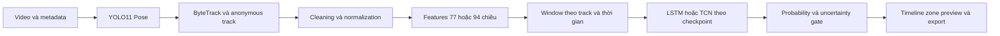

# Hướng dẫn demo trình bày và xử lý yêu cầu thay đổi tại chỗ

Ngày soạn 23/11/2026. Nhóm CVF25PRJ10, đề tài CVFP26BCPPRJC012.

Tài liệu dùng để chuẩn bị buổi trình bày, thao tác demo, giải thích source code và xử lý các yêu cầu chỉnh sửa từ giảng viên. Mốc dữ liệu đang có là bộ pose YOLO11 và 23.394 cửa sổ posefeat-v2. Các lệnh trong tài liệu là kịch bản thực hành, người demo chọn đúng config, checkpoint và dataset tương thích trước khi chạy.

## 1 Kết quả cần thể hiện trong buổi demo

Người xem cần theo dõi được một video đi qua pose, tracking, chuẩn hóa, feature, cửa sổ thời gian, mô hình temporal, uncertainty gate và báo cáo. Nhóm giải thích được dữ liệu đưa vào từng bước, lý do thiết kế, bằng chứng đã kiểm tra và phạm vi kết luận.

Buổi demo nên hoàn tất bốn việc cụ thể.

1. Chạy một đầu vào hợp lệ và mở artifact thật.
2. Truy vết một prediction về đúng cửa sổ, track, thời gian và checkpoint.
3. Thực hiện một thay đổi có kiểm soát, quan sát đầu ra trước và sau.
4. Xử lý một đầu vào lỗi và giải thích thông báo backend.

Mỗi thành viên chuẩn bị câu trả lời theo cấu trúc đầu vào, xử lý, đầu ra, kiểm chứng và giới hạn. Khi được hỏi kết quả khoa học, đọc nguồn nhãn, support từng lớp và phạm vi experiment cùng metric.

## 2 Phân công và khung thời gian

### 2.1 Vai trò trong buổi trình bày

| Thành viên | Phần trình bày | Bằng chứng cần mở sẵn |
|---|---|---|
| Phong | Nguồn video, metadata, phase và nhãn người | Guide, phiếu độc lập, schema, QA report nếu đã có |
| Quân | YOLO11, tracking, cleaning, feature, windows và tích hợp | Pose CSV/Parquet, đoạn code, split report |
| Tài | LSTM/TCN, training, evaluation và calibration | Config run, checkpoint metadata, history, predictions |
| Tiến | Dashboard, preview, uncertainty và export | UI đang chạy, kết quả video mới, bộ export |

Một người giữ bàn phím xuyên suốt demo chính để tránh đổi cửa sổ nhầm. Người phụ trách phần khác giải thích hoặc chỉ source khi cần. Phân công một người ghi yêu cầu thay đổi, kết quả và câu hỏi cần bổ sung.

### 2.2 Kịch bản 15 phút đề xuất

| Thời gian | Nội dung | Màn hình hoặc artifact |
|---|---|---|
| 0–1 phút | Bài toán và đơn vị dự đoán | Sơ đồ luồng |
| 1–3 phút | Dữ liệu, nhãn, split và hiện trạng | split_report.json, annotation guide |
| 3–5 phút | Pose, tracking và feature 94 chiều | Preview đúng người, một dòng pose, tensor shape |
| 5–7 phút | Temporal model và bằng chứng training | Config, checkpoint metadata, history của cùng run |
| 7–11 phút | Chạy demo và xem output | Dashboard hoặc CLI với video ngắn |
| 11–13 phút | Thay confidence threshold và đối chiếu | Hai bộ prediction từ cùng checkpoint/input |
| 13–15 phút | Kết quả, giới hạn và hướng hoàn thiện | Bảng metric đúng experiment, backlog nghiệm thu |

Nếu chỉ có 5 phút, trình bày bài toán trong 30 giây, một artifact dữ liệu trong 1 phút, demo trong 2 phút, thay threshold trong 1 phút và kết quả/giới hạn trong 30 giây. Phần source và training chuyển sang hỏi đáp.

## 3 Kiểm tra trạng thái trước khi nói đã hoàn thành

### 3.1 Những gì đã có bằng chứng trong phiên làm việc

| Hạng mục | Cách trình bày phù hợp |
|---|---|
| Pose YOLO11 | Nhóm đã trích lại pose class/session, giữ artifact và cấu hình tương ứng |
| Feature v2 | Có 23.394 cửa sổ, tensor [23394,40,94], mask và giá trị hữu hạn đã kiểm tra |
| Split | Train 9.888, val 8.617, test 4.889, hash khớp ba file split |
| Weak labels | Có 16.447 cửa sổ có nhãn quy tắc, nguồn WEAK_RULE |
| Quality | 6.639 LOW_VISIBILITY và 308 UNKNOWN_PHASE |
| Công cụ người gán | Có annotation app, re-label app và QA, cần trình bày đúng phiên bản guide được dùng |
| Temporal pipeline | Có LSTM/TCN, hỗ trợ BiLSTM và lưu checkpoint, config, history, evaluation |
| Calibration | Có đường xử lý fit validation và đọc lại temperature/threshold, smoke đã chạy |
| Dashboard | Có video/pose inference, preview, timeline, zone và export |
| Kiểm thử | Lần xác minh ngày 22/11 đạt 152 passed, lưu ngày chạy cùng kết quả |

### 3.2 Những điều cần xác nhận lại trước buổi bảo vệ

- Checkpoint demo được train trên feature 77 hay 94 chiều, dataset nào và pose extractor nào.
- Human annotation đã hoàn tất đến đâu, có QA/Kappa thật và adjudication report hay chưa.
- Metadata phase có những interval nào đã được người xác minh.
- Các benchmark đang mở đo video nào, hardware nào, phạm vi bao nhiêu frame.
- Artifact hiển thị trên các tab có thuộc cùng experiment/lượt inference đang giải thích.

Checkpoint lịch sử ngày 25/10 thường dùng posefeat-v1 77 chiều và dữ liệu weak cũ. Khi dùng checkpoint này, mô tả rõ input/schema và experiment của nó. Có tensor v2 mới chưa đồng nghĩa đã có checkpoint v2 được huấn luyện và nghiệm thu.

Trước buổi trình bày, cập nhật bảng này bằng artifact thực tế mới nhất. Các bước dự kiến trong PLAN_HOAN_THIEN_SAU_POSE_YOLO11_20261122.md chỉ được chuyển thành kết quả đã làm khi có bằng chứng tương ứng.

## 4 Lời dẫn và cách giải thích từng phần

### 4.1 Giới thiệu bài toán

Lời trình bày gợi ý.

“Nhóm xây dựng hệ thống ước lượng mức độ tham gia học tập quan sát được từ tư thế và chuyển động theo thời gian. Mỗi dự đoán gắn với một anonymous track trong một khoảng khoảng 4 giây. Hệ thống xuất ba mức tham gia và có cơ chế UNCERTAIN khi chất lượng hoặc confidence chưa đủ.”

Khi giải thích nhãn, đưa ví dụ gắn nhiệm vụ. Cùng tư thế cúi đầu có thể phù hợp khi đọc/viết, còn phase giảng bài cần quan sát thêm ngữ cảnh. Người gán ghi bằng chứng hành vi và phase theo guide.

### 4.2 Kiến trúc xử lý



“YOLO11 nhận ảnh và trả bounding box cùng 17 keypoint có confidence. ByteTrack nối detection qua thời gian. Nhóm dùng dữ liệu số đã làm sạch để huấn luyện mô hình temporal. Model output được qua quality/confidence gate trước khi tổng hợp.”

Chỉ rõ mô hình temporal là phần nhóm thiết kế cấu hình và huấn luyện trên dữ liệu dự án. Trọng số YOLO pretrained là thành phần trích tư thế.

### 4.3 Dữ liệu pose và tracking

Mở một CSV pose và chọn một dòng. Giải thích các cột session_id, camera_id, frame_idx, timestamp_ms, track_id, bbox, keypoint và confidence. Mỗi dòng ứng với một detection của một người trong một frame đã lấy mẫu.

17 keypoint gồm mũi, mắt, tai, vai, khuỷu tay, cổ tay, hông, gối và cổ chân. Một keypoint có ba giá trị x, y và confidence. Track ID chỉ có ý nghĩa trong recording/camera tương ứng, chất lượng nối ID cần được kiểm tra ở các đoạn che khuất.

558.507 là số detection của sáu session mới trong lần kiểm kê, tổng class_1–5 cần tính thêm khi nói về toàn bộ 11 recording. Phân biệt số detection, số sampled frame, số track và số người thật.

### 4.4 Feature và sliding window

Giải thích 77 chiều cơ sở bằng bảng sau.

| Nhóm | Số chiều |
|---|---:|
| Tọa độ chuẩn hóa 17 điểm | 34 |
| Vận tốc tọa độ | 34 |
| Shoulder slope, head proxy x/y, tay trái/phải, head-down proxy | 6 |
| Motion energy | 1 |
| Visible ratio và mean keypoint confidence | 2 |
| Mask keypoint nối thêm trong v2 | 17 |
| Tổng v2 | 94 |

“Một cửa sổ v2 có 40 bước và 94 giá trị mỗi bước. Batch 32 có shape [32,40,94]. LSTM/TCN trả logits [32,3]. Nhãn y là chỉ số 0/1/2 tương ứng canonical HIGH/MODERATE/LOW.”

Lấy ví dụ mẫu tại 0,0 đến 3,9 giây. Có 40 mẫu ở 10 FPS, cửa sổ tiếp theo bắt đầu khoảng 2 giây. Builder kiểm tra frame và timestamp liên tục. Track thiếu thời gian có thể bị bỏ trước classifier.

Phase, zone và ID hiện là metadata. Phase tham gia cách sinh/diễn giải nhãn, chưa được nối thành kênh input trong 94 chiều hiện tại. Đây là một giới hạn cần nắm rõ khi trả lời câu hỏi về context.

### 4.5 Gán nhãn và nguồn nhãn

Mở phiếu mẫu theo đúng window_id, xem clip và giải thích ba nguồn HUMAN, WEAK_RULE, ADJUDICATED. Người gán xem đúng người, đủ đoạn, xác định nhiệm vụ và chọn state phù hợp. Confidence của người gán khác với confidence dự đoán.

Với bộ hiện tại, tất cả phase_verified đang false và đã bật allow_unverified_phases. Phần audit này cần được trình bày cùng metric weak. Human test còn là hạng mục nghiệm thu nếu nhóm chưa hoàn thành.

Hai người gán độc lập cùng subset, sau đó tính Kappa và phân xử. Nếu dùng rubric v0.3-pilot, giải thích bốn khoảng bằng chứng và trạng thái pilot. Với tool v0.2, mở đúng guide v0.2 và tránh trộn định nghĩa.

### 4.6 Mô hình và huấn luyện

Mở config của experiment đang dùng và chỉ hidden size, layers, dropout, batch size, learning rate, seed, dataset/split version. Mở history của cùng experiment để chỉ train loss và validation Macro-F1. Mở metadata để chỉ checkpoint path và hash.

“Training dùng DataLoader, weighted CrossEntropyLoss và Adam. Mỗi epoch đánh giá validation, lưu checkpoint khi Macro-F1 tăng, dừng khi hết patience. Các dòng y=-1 được loại khỏi supervised loss.”

Với dataset weak hiện tại, train dùng 6.484 mẫu có nhãn, val 6.331 và test 3.632. LOW có 142/304/0 mẫu ở ba tập. Khi được hỏi kết quả lớp LOW trên test, báo support=0 và giới hạn đánh giá.

LSTM baseline kết hợp mean pooling và bước cuối của chuỗi hidden. TCN dùng Conv1d giãn cách và residual, sau đó pooling để phân loại cả cửa sổ. Hai kiến trúc phải so trên cùng dữ liệu và protocol.

### 4.7 Uncertainty và calibration

“Gate kiểm tra visible ratio, pose confidence và xác suất lớn nhất. Khi chưa đủ điều kiện, hệ thống trả UNCERTAIN cùng lý do. Temperature scaling được fit bằng validation khi chạy tùy chọn calibration.”

Mở gate_reason và chỉ ví dụ LOW_VISIBILITY, LOW_KEYPOINT_CONF, LOW_MODEL_CONF, ACCEPTED. Nếu checkpoint không có calibration, giải thích ngưỡng đến từ config/CLI. Nếu có, mở calibration trong checkpoint/metadata và chỉ validation fit.

### 4.8 Dashboard và export

Giải thích timeline là thống kê các cửa sổ theo thời gian bắt đầu. Window chồng lấn, tỷ lệ window có mẫu số riêng và không tự bằng tỷ lệ thời gian hay tỷ lệ người duy nhất. Zone là phân vùng hình học cần đối chiếu góc camera, đọc cùng N và pose quality.

Mở results.csv, timeline.csv, zone_summary.csv, summary.json và summary_report.md từ cùng lượt chạy. Trong shareable export kiểm tra không còn track_id, window_id chứa track ID, bbox hoặc cột free text nhạy cảm. Predictions nội bộ giữ khóa để audit theo quyền truy cập.

## 5 Chuẩn bị trước buổi demo

### 5.1 Danh sách tối thiểu

- Một video ngắn được phép sử dụng, đủ người/track tạo cửa sổ 4 giây.
- Một pose CSV đã kiểm tra của video đó để chạy nhanh khi cần.
- Một checkpoint LSTM và một checkpoint TCN nếu đã có, kèm config/schema tương ứng.
- Một bộ kết quả chạy sẵn và log thời gian, dùng khi trình bày artifact.
- Một video hỏng hoặc CSV thiếu cột làm tình huống kiểm tra lỗi có kiểm soát.
- Config demo riêng và thư mục output riêng cho mỗi lượt thử.
- Tensor metadata, split report, annotation guide, source code và báo cáo kiểm chứng mở sẵn.

Giữ video private ở máy được phép truy cập. Kiểm tra preview trước khi chiếu, gồm cả người detector bỏ sót. Laptop có đủ pin/nguồn, dung lượng và trọng số local, tránh để tải weights lần đầu trong buổi demo.

### 5.2 Lệnh kiểm tra môi trường

Chạy tại thư mục gốc repository bằng PowerShell.

```powershell
Set-Location -LiteralPath 'D:\ThiGiacMayTinh\observable-learning-engagement'
python scripts/check_setup.py
python -m pip check
python -c "import torch; print(torch.__version__); print('CUDA available', torch.cuda.is_available())"
python -m pytest -q -p no:cacheprovider
```

Lưu terminal log có ngày chạy. Số test có thể thay đổi khi code mới thêm test, trình bày kết quả vừa chạy thật.

### 5.3 Kiểm tra nhanh tensor và checkpoint

```powershell
@'
from pathlib import Path
import numpy as np
import torch

dataset = np.load('data/features/window_features.npz', allow_pickle=False)
print('Schema', str(dataset['feature_schema_version']))
for split in ('train', 'val', 'test'):
    x = dataset['X_' + split]
    y = dataset['y_' + split]
    print(split, x.shape, 'labeled', int((y >= 0).sum()))
for path in sorted(Path('models/checkpoints').glob('*.pt')):
    checkpoint = torch.load(path, map_location='cpu')
    print(path.name, checkpoint.get('model_type'), checkpoint.get('input_size'),
          'calibration', bool(checkpoint.get('calibration')))
'@ | python -
```

Chọn checkpoint dựa vào metadata đã đọc. Model từ checkpoint 77 chiều sẽ dùng representation tương ứng ở luồng predict, còn train/evaluate cần tensor có số chiều phù hợp.

## 6 Kịch bản chạy demo chính

### 6.1 Khai báo đường dẫn dùng trong các ví dụ

```powershell
$demoVideo = 'data/raw/class_1.mp4'
$demoPoses = 'data/poses/class_1_cam_A_poses.csv'
$demoCheckpoint = 'models/checkpoints/20261025-162855-lstm-full-v0-1.pt'
$demoConfig = 'configs/experiments/external_demo_yolo11m.yaml'
```

Checkpoint trên là ví dụ lịch sử 77 chiều, dùng để diễn tập pipeline với mô tả đúng experiment. Nếu đã có checkpoint v2 mới, thay cả checkpoint và config tương ứng trước buổi demo. Config demo cần đủ trường video, sequence, quality, uncertainty và reporting.

### 6.2 Mở dashboard

```powershell
python -m streamlit run app/streamlit_app.py --server.port 8501
```

1. Chọn experiment có artifact hợp lệ và checkpoint tồn tại.
2. Chọn loại input video hoặc pose CSV.
3. Chọn extractor phù hợp khi upload video.
4. Để giới hạn frame đủ tạo cửa sổ, thí dụ 60 sampled frame cho đoạn khoảng 6 giây.
5. Bắt đầu xử lý, chỉ log và thời gian thực tế.
6. Xem prediction, coverage, preview, rồi chọn lượt suy luận mới cho timeline/zone/export.
7. Tải summary hoặc tạo export bundle, mở file để đối chiếu.

Nếu demo YOLO11m-HD trên CPU chậm, cho người xem thấy tiến trình và chuyển sang phần giải thích artifact đã tạo trong lúc chờ. Chuẩn bị pose CSV cho phần thử thay đổi nhanh.

### 6.3 Chạy cùng luồng bằng CLI

```powershell
python scripts/predict_video.py --video $demoVideo --checkpoint $demoCheckpoint --config $demoConfig --max-frames 60 --out-dir reports/inference/demo_live_video
python scripts/predict_video.py --poses $demoPoses --checkpoint $demoCheckpoint --config $demoConfig --out-dir reports/inference/demo_live_pose --skip-preview
```

Lệnh thứ hai dùng pose đã có nên thời gian đo chỉ phản ánh phần sau extraction. Các thư mục demo_live là output diễn tập riêng, đổi tên cho các lượt cần giữ bằng chứng.

### 6.4 Truy vết một prediction

Chọn một dòng predictions.csv, đọc window_id, track_id, t_start_ms/t_end_ms, quality, p_max và gate_reason. Mở pose đúng recording/track/time và xem clip. Đối chiếu feature schema với input_size checkpoint. Mở inference_meta.json để chỉ config, checkpoint, temperature, threshold và số cửa sổ.

Từ một dòng kết quả, người trình bày phải truy vết được về data, config và model mà không dựa vào trí nhớ hoặc tên file gợi ý.

## 7 Quy trình tiếp nhận yêu cầu chỉnh sửa tại chỗ

Khi giảng viên đưa yêu cầu, xác định hành vi đầu ra mong muốn và phạm vi dữ liệu dùng thử. Với yêu cầu chưa cụ thể, hỏi ngắn về kết quả mong muốn trước khi sửa.

1. Xác định tham số/module sở hữu hành vi đó bằng sơ đồ ở mục 8.
2. Dự đoán phần đầu ra có thể thay đổi và cách đo sự thay đổi.
3. Tạo config hoặc output riêng cho lượt thử, lưu input/checkpoint/config trước thay đổi.
4. Thực hiện thay đổi nhỏ nhất đáp ứng yêu cầu.
5. Chạy kiểm tra trọng tâm rồi qua entry point bình thường.
6. So sánh artifact trước/sau, báo thay đổi quan sát được và giới hạn.
7. Nếu phát hiện lỗi, quay về cấu hình đã lưu hoặc sửa tiếp dựa trên lỗi. Tránh dùng lệnh khôi phục toàn working tree vì có thể mất công việc đang làm.

Các yêu cầu về thuật toán cần thời gian train/gán nhãn được trình bày bằng thay đổi source/config có thể kiểm tra ngay và phần thực nghiệm cần hoàn tất sau. Không hứa rằng mọi yêu cầu sẽ hoàn tất trong vài phút.

## 8 Bảng tra vị trí thay đổi

| Yêu cầu | Vị trí chính | Có thể cần dựng lại hoặc train |
|---|---|---|
| Confidence threshold | predict_video CLI, uncertainty/gate.py | Inference lại hoặc gate lại probability đầy đủ |
| Đổi YOLO/imgsz/conf | extract_pose CLI, config pose, extractor.py | Extraction lại, đánh giá distribution feature |
| Đổi tracker | config tracking, pose/tracker.py | Pose tracking lại, annotation mapping phải review |
| Thay quality gate | preprocessing/windows.py, quality_gate.py, uncertainty/gate.py | Audit lại dataset và inference policy |
| Window/stride/FPS | build_dataset CLI, preprocessing/windows.py | Dataset/annotation alignment, evaluation và có thể retrain |
| 77 sang 94 chiều | features.py, feature_contract.py, config | Build v2 và train checkpoint tương thích |
| LSTM sang TCN/BiLSTM | models/factory.py, config, train CLI | Train model mới và evaluate cùng protocol |
| Đổi batch/lr/dropout | train CLI/config | Run mới và ghi snapshot |
| Gán nhãn lại | annotation app/relabel app, annotation_io.py | QA, adjudication, join label và dataset version |
| Timeline theo phút/pha | reporting/aggregation.py, dashboard | Tổng hợp lại từ prediction |
| Heatmap/zone | configs/zones, assign_zones.py, reporting | Ánh xạ lại zone và aggregation |
| Export | reporting/exporter.py | Xuất bundle và kiểm tra schema/privacy |
| Thay UI | app/streamlit_app.py | AppTest và trình duyệt thật |
| Split/label semantics | contracts, scope, split files, consumers | Version/protocol mới và review tác động |

## 9 Các tình huống thay đổi cụ thể

### 9.1 Tăng threshold để giảm số kết luận confidence thấp

Giải thích cơ chế rồi chạy cùng pose và checkpoint ở hai ngưỡng.

```powershell
python scripts/predict_video.py --poses $demoPoses --checkpoint $demoCheckpoint --config $demoConfig --min-probability 0.60 --out-dir reports/inference/demo_tau060 --skip-preview
python scripts/predict_video.py --poses $demoPoses --checkpoint $demoCheckpoint --config $demoConfig --min-probability 0.80 --out-dir reports/inference/demo_tau080 --skip-preview
```

Đối chiếu p_max/pred_label phải giữ nguyên khi cùng model/preprocessing/temperature. Số accepted ở 0.80 không lớn hơn ở 0.60. Quality rejection vẫn có thể xảy ra ở cả hai ngưỡng. Độ đúng accepted chỉ được tính khi có nhãn tham chiếu phù hợp.

```powershell
@'
import pandas as pd
for name in ('demo_tau060', 'demo_tau080'):
    frame = pd.read_csv('reports/inference/' + name + '/predictions.csv')
    accepted = frame.gated_label.ne('UNCERTAIN')
    print(name, 'N', len(frame), 'accepted', int(accepted.sum()),
          'coverage', float(accepted.mean()))
    print(frame.gate_reason.value_counts().to_dict())
'@ | python -
```

### 9.2 Đổi extractor sang YOLO11m hoặc đổi độ phân giải

Chạy output riêng trên một đoạn ngắn.

```powershell
python scripts/extract_pose.py --video $demoVideo --session demo_yolo11 --camera cam_A --track --model yolo11m-pose.pt --imgsz 1280 --conf 0.35 --sample-fps 10 --max-frames 60 --output data/demo_runs/yolo11_1280_poses.csv --format csv
```

Đổi --imgsz sang 640 ở một output khác để so số detection, visible ratio, confidence và thời gian. Các nhóm detection có thể khác nhau, cần đối chiếu cùng người/zone nếu kết luận chất lượng. Lưu config và lý do đổi extractor trong run metadata.

### 9.3 Chuyển sang TCN hoặc BiLSTM

Chọn checkpoint TCN đã train trên cùng feature/split nếu có, chạy predict cùng input. Muốn đổi kiến trúc và huấn luyện tại chỗ, dùng config run riêng và smoke ngắn.

```powershell
python scripts/train.py --features data/features/window_features.npz --config <config-thi-nghiem-day-du.yaml> --model tcn --name demo-tcn-smoke --epochs 1 --device cpu --notes "live software smoke on weak labels"
python scripts/train.py --features data/features/window_features.npz --config <config-thi-nghiem-day-du.yaml> --model bilstm --name demo-bilstm-smoke --epochs 1 --device cpu --notes "live software smoke on weak labels"
```

Thay placeholder trước khi chạy. Một epoch cho thấy luồng train/checkpoint chạy được, kết luận hiệu năng cần các run đầy đủ theo protocol. Dùng kiến trúc checkpoint thực tế thay vì chỉ thay tên hiển thị UI.

### 9.4 Đổi cửa sổ 4 giây thành 2 hoặc 6 giây

Đổi window bằng CLI build trong output riêng, kiểm tra shape mới 20 hoặc 60 bước khi FPS=10. Cần đảm bảo thư mục pose đầu vào chỉ chứa các recording thuộc split chỉ định.

```powershell
python scripts/build_dataset.py --poses-dir data/poses --splits-dir data/splits --config <config-thi-nghiem-day-du.yaml> --feature-version v2 --window-seconds 2 --stride-seconds 1 --labels weak --dataset-version demo-window2s --output-dir data/demo_features/window2s
```

Những đoạn chưa xác minh phase có thể không có weak label. Human label gắn cửa sổ 4 giây cần quy trình align/gán lại khi chuyển thời gian. Cần retrain và đánh giá cấu hình mới trước khi chọn làm hệ thống cuối, dù kiến trúc có thể nhận sequence length khác về mặt shape.

### 9.5 Tăng tốc demo

Ưu tiên giới hạn đoạn video được chạy, dùng pose CSV đã chuẩn bị, chọn model extractor nhỏ hơn nếu mục tiêu cho phép, dùng CUDA khi máy có hỗ trợ và đo từng công đoạn. Chỉ giảm FPS khi điều chỉnh đồng thời velocity, window timesteps và consumer tương ứng.

Báo rõ thời gian đang đo extraction, temporal model hay end-to-end. Warmup/model load và render preview có thể chiếm phần đáng kể. Nếu dùng dữ liệu chạy sẵn, nói rõ đó là artifact của lượt đã ghi log.

### 9.6 Đổi quality gate cho lớp học ngồi bàn

Tạo config thử nghiệm, kiểm tra allow_upper_body_visibility và upper_body_min_visible_ratio. Đo coverage và xem thủ công các trường hợp mới được chấp nhận. Dùng cùng policy khi build và inference, giữ thông tin chất lượng trước nội suy.

Không suy ra chất lượng đã tốt chỉ từ việc giảm tỷ lệ UNCERTAIN. Phần gán nhãn, đánh giá accepted và lỗi keypoint cần được xem cùng kết quả coverage. Đây là thay đổi cần validation riêng trước chốt ngưỡng cuối.

### 9.7 Gán lại một mẫu và chứng minh dữ liệu đã lưu

Mở phiếu diễn tập riêng, xem đúng track, chọn phase và bằng chứng, lưu một nhãn, mở lại CSV để chỉ đúng window_id và provenance. Chạy schema QA trên phiếu đó. Nếu dùng AnnotationStudio, kiểm tra output có khóa khớp builder hoặc adapter nối khóa đã được kiểm thử.

```powershell
python -m streamlit run app/relabel_app.py --server.port 8502
python scripts/dataset_qa.py --validate <phieu-demo.csv> --require-human
```

Phiếu demo tách khỏi bộ đánh giá chính để không vô tình sửa nhãn test trong lúc minh họa. Khi sửa nhãn dataset thật, có version và log căn cứ.

### 9.8 Chỉ hiển thị một phase hoặc đổi bucket timeline

UI hiện có lựa chọn phase nếu prediction chứa phase hợp lệ và bucket tổng hợp khi export. Chọn bộ dữ liệu của lượt inference vừa chạy trước khi thao tác. Nếu inference chưa có metadata phase, cần bổ sung nguồn context hợp lệ rồi mới tổng hợp theo phase.

Nếu cần sửa code aggregation, kiểm tra tổng N qua các bucket khớp input, không trộn session chỉ vì timestamp đều bắt đầu từ 0. Với bucket 30/60/120 giây, nhãn từng window giữ nguyên, thay đổi thuộc cách tổng hợp.

### 9.9 Thay vùng lớp hoặc thêm báo cáo theo camera

Mở config zones để đổi lưới, đối chiếu vị trí trên ảnh và giữ zone_source. Tạo kết quả gán vùng ở output riêng, xem bảng N và quality từng nhóm. Khi thêm camera grouping, cập nhật backend và schema export, kiểm tra cùng track_id giữa camera khác nhau không bị gộp nhầm.

### 9.10 Thêm một cột hoặc biểu đồ

Xác định cột có sẵn trong prediction hay phải tính ở backend. Nếu đã có, thêm vào biểu đồ/summary, kiểm tra empty data, missing values và unit. Nếu cần tính mới, đặt logic trong src/reporting hoặc preprocessing đúng trách nhiệm, sau đó UI gọi lại.

Ví dụ thêm tỷ lệ UNCERTAIN theo phút có thể dùng count sẵn của aggregate_timeline. Mẫu số phải được ghi là số window trong bucket. Kiểm tra bảng gốc và chart khớp ở một bucket cụ thể.

### 9.11 Thêm video class_6 hoặc class_7 vào demo

Video mới có thể chạy predict độc lập với split training. Muốn đưa vào training, phải xác minh nguồn recording/quyền sử dụng, gán nhãn và lập split/dataset version phù hợp. Không đưa recording mới vào thư mục builder đang giữ split-v0.1 rồi coi là tự nhận đúng tập.

### 9.12 Tăng accuracy hoặc bổ sung lớp mới

Với yêu cầu cải thiện hiệu năng, xác định metric, nguồn nhãn, lớp/nhóm lỗi và chi phí chấp nhận. Kiểm tra confusion matrix, phase, pose quality, mất cân bằng và sai annotation trước khi chọn thí nghiệm validation.

Với lớp mới, cần định nghĩa quan sát được, guide và annotation tương ứng, cập nhật label contract/model head/loss/evaluator/UI, tạo dataset và train lại. Trình bày dependency và một patch cụ thể có thể review, tránh hứa hoàn tất ngay một thay đổi cần dữ liệu mới.

### 9.13 Đổi split hoặc thu thập thêm dữ liệu

Nếu phát hiện leakage từ recording nguồn, lập báo cáo và protocol split mới, version hóa rồi tái chạy thí nghiệm. Khi được yêu cầu chia lại để điểm test cao hơn, giải thích ảnh hưởng tới tính so sánh và đề nghị thí nghiệm trên validation hoặc tập bổ sung với protocol rõ.

## 10 Câu hỏi thường gặp và cách trả lời

| Câu hỏi | Nội dung cần trả lời |
|---|---|
| Nhóm đã tự train phần nào | LSTM/TCN temporal classifier, chỉ đúng experiment và artifact. YOLO dùng pretrained weights |
| Vì sao 94 chiều | 77 kênh cơ sở cộng 17 mask, giúp mô hình nhận biết sự thiếu dữ liệu rõ hơn |
| Vì sao phải dùng chuỗi | Nhiều hành vi cần diễn biến thời gian, cửa sổ là đơn vị quan sát và phân loại |
| Cúi đầu có bị LOW hết không | Nhãn xét nhiệm vụ và bằng chứng, rule có hạn chế và cần human test |
| Giơ tay có chắc HIGH không | Rule là heuristic, người gán xét toàn cửa sổ và phase theo guide |
| Điểm 0,9 chứng minh điều gì | Đọc metric_scope và nguồn nhãn của run trước, báo support, split và uncertainty |
| Vì sao cần UNCERTAIN | Giảm kết luận khi input/confidence thiếu căn cứ, báo cùng coverage |
| Coverage cao có tốt hơn không | So với accepted performance và chất lượng detection/tracking, ghi đúng mẫu số |
| Test không có LOW thì sao | Support LOW=0, báo giới hạn, human review và tập đánh giá bổ sung theo protocol |
| Làm sao tránh leakage | Group theo nguồn recording/người/ngày khi khả thi, kiểm tra split và source audit |
| Có nhận biết được nhìn bảng hay hiểu bài không | Pose cho proxy hình học, kết quả ở phạm vi hành vi quan sát được theo context |
| Vì sao dùng YOLO11m | Chọn cấu hình extractor theo yêu cầu/đo thực tế, nêu trade-off tốc độ và chất lượng cùng scope benchmark |
| Hệ thống realtime chưa | Dẫn số đo end-to-end trên hardware/video cụ thể, không suy ra từ latency riêng LSTM |
| Làm sao tái lập | Config snapshot, seed, git revision, dataset/split/schema version, input/weights hashes và command |
| Trường hợp mất ID | Xem pose/tracking preview và log fragment, giữ window continuity, kiểm chứng nối track bằng GT |

## 11 Xử lý lỗi trong buổi demo

| Triệu chứng | Kiểm tra ngay | Cách xử lý |
|---|---|---|
| Không có window | Đủ 40 bước liên tục, track duration, timestamps, FPS | Dùng đoạn dài hơn hoặc pose canonical đã kiểm tra |
| Feature dimension mismatch | NPZ F, checkpoint input_size và feature schema | Chọn đúng cặp dataset/checkpoint, dựng run tương thích nếu cần |
| No completed labels | y>=0 theo từng split, HUMAN join, window_id | Mở report matched/unmatched, hoàn tất nhãn thật hoặc dùng exploratory weak run có scope |
| Session ngoài split | File external/class_6/7 lẫn trong poses-dir | Dùng thư mục manifest đúng split hoặc config/version dataset mới |
| Không có clip đúng người | session/camera/time/track, video path, pose path | Sửa mapping nguồn, giữ trạng thái thiếu bằng chứng khi không định vị được |
| Preview không phát | Codec H.264, file hoàn tất, browser media | Dùng preview đã encode và kiểm tra, giữ log lỗi codec |
| CSV lỗi dtype | Cột confidence, ID và ô trống | Dùng annotation_io và QA, giữ ID dạng text |
| Heatmap rỗng | zone_id, hệ mã zone và tập dữ liệu được chọn | Gán zone bằng cấu hình đúng camera, tổng hợp lại |
| Dashboard hiện dữ liệu cũ | Experiment selection, latest inference và cache | Chọn đúng lượt, reload dữ liệu, đối chiếu path artifact |
| CUDA lỗi | torch.cuda.is_available và môi trường GPU | Chạy CPU cho smoke, ghi đúng thiết bị và thời gian |
| Memory tăng mạnh | Số window, batch, evaluate toàn tensor | Dùng inference batch phù hợp và subset smoke có manifest |
| Trình diễn chậm | Pose HD, CPU load, preview render | Chạy đoạn ngắn, dùng pose CSV cho bước sau extraction |

Khi gặp lỗi, đọc dòng exception gốc và input liên quan. Dùng một phép thử nhỏ để xác nhận chẩn đoán trước khi sửa nhiều thành phần. Sau sửa, chạy lại entry point đã lỗi để chứng minh đã khắc phục.

## 12 Kiểm tra trước sau thay đổi và ghi bằng chứng

### 12.1 Lệnh kiểm thử theo nhóm

```powershell
python -m pytest tests/test_uncertainty_gate.py tests/test_update_regressions.py -q
python -m pytest tests/test_pose_extractor.py tests/test_pose_cleaning.py -q
python -m pytest tests/test_feature_shapes.py tests/test_split_contract.py -q
python -m pytest tests/test_lstm_pipeline.py tests/test_tcn_pipeline.py -q
python -m pytest tests/test_reporting_export.py tests/test_reporting.py -q
python -m pytest tests/test_annotation_app.py tests/test_annotation_evidence_and_preview.py -q
python -m compileall -q app src scripts
git diff --check
```

Chạy nhóm phù hợp với thay đổi và một smoke qua luồng thật. Khi thay đổi có ảnh hưởng rộng, chạy lại toàn suite. Kiểm thử source thành công cần đi cùng kiểm tra artifact thực tế và thao tác UI tương ứng.

### 12.2 Phiếu ghi thay đổi

Mỗi yêu cầu ghi một dòng trong nhật ký buổi demo với các trường sau.

| Trường | Nội dung cần ghi |
|---|---|
| Yêu cầu | Hành vi đầu ra mà giảng viên mong muốn |
| Phạm vi | UI/config/inference/dataset/model/contract |
| Input | Video/pose/dataset và hash hoặc manifest |
| Model | Checkpoint và config/schema |
| Thay đổi | File hoặc tham số, giá trị cũ và mới |
| Kết quả | Artifact trước/sau, N, metric hoặc thông báo lỗi |
| Kiểm tra | Command, exit code, test/smoke/UI đã thực hiện |
| Còn lại | Dữ liệu hoặc thực nghiệm cần thêm để nghiệm thu |

Đặt screenshot/log vào thư mục buổi demo sau khi review privacy. Ghi lại hướng dẫn tái lập đủ để người khác chạy lại, tránh phụ thuộc các biến shell chưa được khai báo hoặc config local thất lạc.

## 13 Checklist diễn tập cuối cùng

- Nhóm giải thích được cả pipeline trong 90 giây.
- Mỗi người mở đúng file sở hữu và giải thích được một hàm trọng tâm.
- Một video được chạy đầy đủ, một pose CSV được chạy nhanh.
- Checkpoint, dataset, extractor và schema được giới thiệu đúng phạm vi.
- Một prediction được truy về đúng người/thời gian/model.
- Demo threshold 0.60/0.80 có artifact đối chiếu và gate reason.
- Input lỗi tạo thông báo có thể giải thích và có cách khắc phục đã thử.
- Timeline, zone và export đọc từ đúng run, các tổng N được kiểm tra.
- Human/weak provenance, phase chưa xác minh và lớp LOW thiếu được giải thích nhất quán.
- Preview/export đã được review cho phạm vi công bố.
- Thay đổi live có config/output riêng và có thể quay lại cấu hình diễn tập.
- Kết quả benchmark, tests và thí nghiệm được trích từ log có ngày chạy.

## 14 Hồ sơ nên mở sẵn trên máy

1. `docs/PLAN_HOAN_THIEN_SAU_POSE_YOLO11_20261122.md` để đối chiếu backlog.
2. `docs/scope.md`, `docs/dataset_schema.md` và guide annotation đang áp dụng.
3. `data/features/split_report.json`, metadata window và ba file split.
4. Pose CSV của video demo và clip đúng track/thời gian.
5. Config snapshot, metadata, metrics, history và predictions của experiment demo.
6. `src/preprocessing/features.py`, `windows.py`, `weak_labels.py` và `src/uncertainty/gate.py`.
7. `src/models/lstm.py`, `tcn.py`, `src/training/trainer.py` và `scripts/predict_video.py`.
8. Dashboard, terminal chạy CLI, thư mục artifact và log kiểm thử.

Chuẩn bị hồ sơ này giúp mỗi lời giải thích đi cùng source hoặc artifact kiểm chứng, đồng thời xác định rõ phần cần thực nghiệm tiếp theo khi giảng viên đưa yêu cầu mới.
