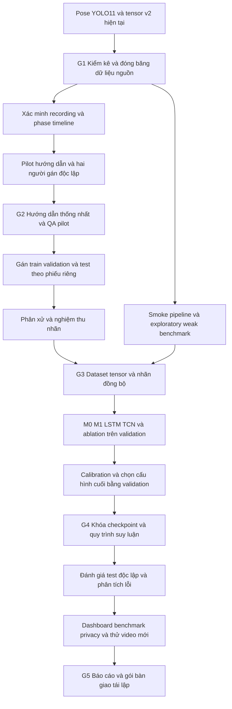

# Kế hoạch hoàn thiện dự án sau trích xuất pose YOLO11

Ngày lập 22/11/2026. Dự án CVF25PRJ10, đề tài CVFP26BCPPRJC012.

Kế hoạch bắt đầu từ pose YOLO11 đã trích và tensor v2 đang có. Đích bàn giao gồm dataset có nguồn nhãn rõ ràng, mô hình temporal được huấn luyện tái lập, đánh giá với nhãn người độc lập, dashboard chạy video mới, báo cáo giới hạn và gói chạy lại. Các công việc dưới đây là kế hoạch tiếp theo. Tên config, thư mục và báo cáo chưa tồn tại được ghi như đầu ra cần tạo.

## 1 Mốc xuất phát và các quyết định cần chốt

### 1.1 Dữ liệu đã kiểm tra

| Hạng mục | Kết quả ngày 22/11 |
|---|---|
| Pose nguồn | Bộ class và session mới được nhóm trích bằng YOLO11m |
| Tensor hiện tại | 23.394 × 40 × 94, float32, số hữu hạn |
| Representation | posefeat-v2, gồm 77 kênh cơ sở và 17 mask |
| Cửa sổ | 4 giây danh nghĩa, 10 FPS, stride 2 giây |
| Train | 9.888 cửa sổ, 6.484 có nhãn WEAK_RULE |
| Validation | 8.617 cửa sổ, 6.331 có nhãn WEAK_RULE |
| Test | 4.889 cửa sổ, 3.632 có nhãn WEAK_RULE |
| INVALID | 6.639 LOW_VISIBILITY và 308 UNKNOWN_PHASE |
| LOW | Train 142, validation 304, test 0 |
| Xác minh phase | Tất cả window hiện có phase_verified=False |
| Tests | Lần kiểm tra gần nhất đạt 152 passed |

Ba file split đã kiểm tra hash. Train gồm class_1–5, session_001–002. Validation gồm session_003–004. Test gồm session_005–006. Class_6 và class_7 được giữ ngoài tập này. Hai video external thuộc nhóm đánh giá bổ sung và phải có manifest riêng.

### 1.2 Các quyết định vận hành đề xuất

1. Đặt version dữ liệu khám phá hiện tại là `v0.2-yolo11-feat94-weak`. Bộ nhãn người sau nghiệm thu mang version riêng, thí dụ `v0.3-yolo11-feat94-human`.
2. Dùng LSTM và TCN làm hai mô hình temporal chính. BiLSTM là thí nghiệm bổ sung khi đủ thời gian.
3. Dùng nhãn người độc lập cho đánh giá cuối. Có thể dùng weak labels ở train trong thí nghiệm được đặt tên rõ.
4. Pilot và chốt hướng dẫn trên train/validation trước vòng gán test cuối.
5. Giữ test đóng băng. Khi cần dữ liệu bổ sung để đánh giá một lớp đang thiếu, lập tập đánh giá bổ sung và version riêng.
6. Giữ các ngưỡng hiện tại làm điểm xuất phát. Chọn giá trị cuối bằng validation theo tiêu chí được ghi trước.

Nhóm xác nhận các lựa chọn này trong biên bản bắt đầu. Ngưỡng chất lượng, số mẫu gán và lịch phía dưới là mục tiêu vận hành đề xuất, cần điều chỉnh theo nguồn lực thực tế.

## 2 Luồng thực hiện và các điểm nghiệm thu



| Điểm nghiệm thu | Điều kiện chuyển giai đoạn |
|---|---|
| G1 | Có manifest pose/config/hash, kiểm tra nguồn recording, split và danh sách ngoại lệ |
| G2 | Pilot độc lập hoàn tất, phân tích bất đồng, rubric version được nhóm thống nhất |
| G3 | Nhãn được QA, tensor/metadata/label khớp, nguồn nhãn theo split được xác nhận |
| G4 | Model, preprocessing, feature schema, temperature và threshold cuối đã khóa bằng validation |
| G5 | Kiểm tra hệ thống và tái lập đạt, báo cáo đầy đủ giới hạn, người khác chạy được gói bàn giao |

## 3 Phân công và lịch dự kiến

| Thành viên | Trách nhiệm chính | Đầu ra cần bàn giao |
|---|---|---|
| Phong | Dữ liệu, phase, annotation, dataset QA | Metadata đã review, phiếu người gán, báo cáo đồng thuận |
| Quân | Pose, tracking, window, ghép nhãn và tích hợp | Manifest, dataset version, công cụ dữ liệu và pipeline |
| Tài | Đồng gán, mô hình, train, ablation, calibration, evaluation | Phiếu độc lập, experiment, checkpoint và báo cáo metric |
| Tiến | Dashboard, anonymization, export, packaging | Demo, báo cáo tổng hợp và gói bàn giao |

Reviewer phân xử do nhóm thống nhất. Phong và Tài hoàn thành vòng độc lập trước khi cùng xem bất đồng. Nếu Tài đã xem test ground truth để gán nhãn, việc tuning vẫn chỉ dùng validation, cần ghi vai trò và kiểm soát truy cập artifact test trong nhật ký.

| Giai đoạn | Thời lượng làm việc dự kiến | Có thể song song |
|---|---|---|
| Kiểm kê và version | 0,5–1 ngày | Smoke pipeline |
| Phase và độc lập recording | 1–2 ngày | Sửa công cụ phiếu/preview |
| Pilot annotation | 1–2 ngày | Chuẩn bị M0/M1 |
| Annotation chính và phân xử | 3–7 ngày, tùy số mẫu | Tích hợp dashboard, benchmark kỹ thuật |
| Dataset nghiệm thu | 0,5–1 ngày | Viết mô tả dữ liệu |
| Model và ablation | 2–4 ngày, tùy CPU/GPU | UI/export QA |
| Calibration và test cuối | 1–2 ngày | Chuẩn bị báo cáo |
| Demo, benchmark và đóng gói | 2–3 ngày | Hoàn thiện tài liệu |

Mốc tổng thể đề xuất khoảng 3–4 tuần khi có hai người gán và đủ thời gian compute. Thời gian thực phải được cập nhật sau pilot. Đo thời gian gán trung vị, nhân với số phiếu, cộng thời gian review và QA để ước lượng nguồn lực.

## 4 Giai đoạn 1 Kiểm kê và đóng băng nguồn

**Owner Quân, Phong hỗ trợ. Liên quan T15–T19.**

### Công việc

1. Lập danh sách 11 recording dùng trong split. Ghi path video và pose, camera, duration, FPS lấy mẫu, số frame/detection, số track, timestamp đầu/cuối.
2. Lưu hash SHA256 video, pose, YAML và ba file split. Video chỉ tham chiếu bằng đường dẫn private trong bản manifest nội bộ.
3. Ghi extractor YOLO11m, weights hash, Ultralytics version, imgsz, confidence, tracker, thiết bị và lệnh đã chạy. Thiếu log thì ghi trường chưa xác minh và đối chiếu artifact.
4. Chọn một representation lưu trữ canonical cho builder. Nếu giữ cả CSV/Parquet, kiểm tra nội dung tương đương và builder không đọc hai lần cùng recording.
5. Đặt bộ dữ liệu hiện tại vào thư mục version riêng trước lần build tiếp theo. Tránh dùng `data/features` như nơi ghi đè mọi thí nghiệm.
6. Kiểm tra các file external, class_6/7 và bản backup không được đọc vào split cũ. Dùng staging directory có manifest chỉ chứa 11 recording khi cần.
7. Tạo config thí nghiệm đầy đủ, dự kiến `configs/experiments/yolo11_feat94_weak_v02.yaml`. Snapshot phải chứa model temporal, sequence, quality, uncertainty và reporting, ngoài cấu hình pose.

### Đầu ra

- `reports/dataset_v02/pose_manifest.csv` và `source_manifest.json`.
- `data/features_v02_yolo11_weak/` chứa bản dữ liệu khám phá có version đồng bộ.
- Cấu hình LSTM/TCN riêng cho feature v2 và dữ liệu mới.

### Điều kiện G1

Không thiếu recording trong split, không có khóa pose trùng, dữ liệu keypoint/mask đúng schema, temporal coverage được đo. Version phải khớp giữa NPZ, metadata window, split/build reports và config. Ghi rõ ngoại lệ có trách nhiệm xử lý.

Kiểm tra code bằng các lệnh hiện có.

```powershell
python scripts/check_setup.py
python -m pytest -q -p no:cacheprovider
python scripts/audit_dataset.py --windows data/features/participation_windows.csv --raw-dir data/raw --output reports/dataset_v02/audit_before_review.json
```

## 5 Giai đoạn 2 Xác minh ngữ cảnh và nguồn recording

**Owner Phong, Quân hỗ trợ. Liên quan T03/T09/T18/T19.**

### Công việc

1. Xem video và đối chiếu ghi nhận buổi học để xác định phase thực tế. Ghi interval bắt đầu/kết thúc, người review, ngày review và căn cứ.
2. Đoạn chưa xác định giữ UNKNOWN. Chỉ gắn verified cho chính interval đã kiểm tra. Timeline phải dùng thời gian local của từng video.
3. Nếu session được cắt từ video dài, lưu video nguồn và offset cắt. Chuyển timeline nguồn sang timestamp local chính xác.
4. Kiểm tra các session train/val/test có cùng recording gốc, người hoặc ngày quay hay không. Tách tên session chỉ kiểm soát được membership theo tên.
5. Nếu phát hiện recording leakage, ghi lỗi nghiệm thu và lập split version mới trước thí nghiệm chính thức. Lưu split-v0.1 để đối chiếu. Quyết định sửa phải dựa vào nguồn dữ liệu và protocol.
6. Kiểm tra đồng thuận/quyền sử dụng, camera/viewpoint và định nghĩa vùng. Zone hình học cần ánh xạ với ảnh thực tế.

### Đầu ra và nghiệm thu

Metadata 11 video, bảng source-recording mapping, phase timeline đã review, log đoạn UNKNOWN và báo cáo leakage. Giai đoạn này hoàn tất khi mỗi khai báo được gắn trạng thái xác minh hoặc ngoại lệ rõ ràng. Nếu chưa giải quyết được độc lập recording, kết quả nghiên cứu phải giới hạn theo phạm vi dữ liệu thực tế.

## 6 Giai đoạn 3 Chốt đơn vị gán nhãn và pilot

**Owner Phong và Tài, Quân chuẩn bị tooling. Liên quan T04/T11/T12.**

### Chuẩn bị đơn vị và công cụ

1. Mỗi phiếu tương ứng session + camera + track + thời gian và window_id. Dùng cùng danh sách window cho hai reviewer.
2. Chọn guide v0.2 hoặc hoàn thiện rubric v0.3-pilot qua pilot. Khác biệt MODERATE phải được thống nhất, lưu version và ghi ví dụ rõ.
3. Video hiển thị đúng người, đủ đoạn, có ngữ cảnh trước/sau khi cần. Hình đại diện hỗ trợ tìm người, người gán vẫn xem toàn bộ đoạn.
4. Phiếu độc lập ẩn nhãn weak, prediction và câu trả lời đối phương. Không prefill HIGH/MODERATE/LOW từ heuristic.
5. Kiểm tra tool có thể lưu các trường guide version, provenance, evidence, phase và trạng thái thiếu dữ liệu.

### Pilot đề xuất

- Nhóm luyện tập chung 20–30 cửa sổ train/val để thống nhất cách hiểu.
- Nhóm pilot độc lập 50–100 cửa sổ khác, có nhiều session, vị trí, pha và chất lượng.
- Hai người gán trạng thái, hành vi, phase, bằng chứng, mức tham gia và confidence riêng.
- Tính đồng thuận nhãn và thống kê bất đồng về state/phase. Báo N hợp lệ và tỷ lệ không thể gán.
- Dùng Kappa 0,60 làm ngưỡng review đang có trong dự án. Nếu thấp, xem lại guide và gán lại mẫu liên quan theo version mới. Chốt guide trước vòng test chính thức.

### Kiểm tra tương thích window ID

App re-label cho annotation legacy có thể tạo khóa dạng `legacy_<hash>`. Builder human hiện ghép theo window_id của tensor. Quân phải kiểm tra định dạng đầu ra của tool nhóm chọn, kể cả AnnotationStudio standalone. Nếu khác, tạo adapter nối theo session/camera/track/time với kiểm tra một-một và xuất window_id canonical. Không ghép gần đúng thời gian một cách im lặng.

Đầu ra G2 gồm guide version, phiếu pilot độc lập, QA report, log phân xử và thống kê thời gian gán. App tồn tại chưa đủ để chứng minh khâu nối dữ liệu đã đạt.

## 7 Giai đoạn 4 Gán nhãn chính và kiểm soát chất lượng

**Owner Phong và Tài. Liên quan T12/T16/T19.**

### 7.1 Thiết kế lượng mẫu

Phương án nguồn lực khuyến nghị ban đầu là 1.000–1.500 cửa sổ train, 400–600 validation và 600–1.000 test. Đây là dự toán làm việc, chưa bảo đảm độ chính xác thống kê. Số cuối được chốt sau pilot, dựa vào thời gian gán, số mẫu hợp lệ, độ đa dạng và uncertainty của metric.

Nếu nguồn lực hạn chế, bắt đầu 200 train, 100 val và 300 test như một đợt review đầu. Dùng kết quả để lập kế hoạch mở rộng. Số test ít cần được báo rõ trong nghiệm thu.

Double annotation ít nhất 15–20% theo kế hoạch dự án. Khuyến nghị double toàn bộ test nếu nguồn lực cho phép. Tập train có thể ưu tiên bổ sung các hành vi/điều kiện ít mẫu sau pilot. Tập đánh giá chính chọn theo thiết kế lấy mẫu đã ghi trước.

### 7.2 Lấy mẫu đúng phạm vi đánh giá

Script hiện phân tầng theo session và weak label. Dùng cách này để tạo review set bao phủ đa dạng, ghi rõ cách chọn. Muốn ước lượng hiệu năng theo phân bố vận hành cần mẫu đại diện hoặc trọng số xác suất lấy mẫu phù hợp.

Quân bổ sung manifest lấy mẫu theo session, time block, track, zone và quality. Kiểm tra các cửa sổ chồng lấn hoặc cùng track có mức phụ thuộc lớn, báo cả N window và số nhóm thời gian/track. Không dùng kết quả mô hình để chọn các cửa sổ dễ cho test.

Lệnh hiện có cho đợt review ban đầu sau khi đã chốt đường dẫn dataset version.

```powershell
python scripts/sample_annotation_subset.py --windows data/features_v02_yolo11_weak/participation_windows.csv --out-dir data/annotations/review_v03 --n-train 200 --n-val 100 --n-test 300 --seed 42
```

Lưu ý `--n-test 0` trong CLI nghĩa là lấy toàn bộ test. Với tập mẫu lớn hơn, thay số trên bằng quota đã chốt. Nếu phiếu mới chưa xuất hiện trong dropdown của app, cấu hình dataset registration và kiểm tra đúng path trước khi giao người gán.

### 7.3 Quy trình từng người gán

1. Chọn đúng tên và bộ phiếu.
2. Xác định track và xem toàn cửa sổ.
3. Xác minh phase, xem ngữ cảnh nếu cần.
4. Ghi hành vi/bằng chứng, trạng thái và confidence.
5. Chỉ chọn nhãn tham gia khi VALID và đủ bằng chứng theo guide.
6. Lưu rồi mở lại để kiểm tra. Tải CSV cá nhân khi bàn giao.

Dòng VALID mang HUMAN, hoặc ADJUDICATED sau phân xử. Dòng OCCLUDED/TRANSITION/INVALID để trống participation_label/source/rule version. Tên ngắn chỉ dùng hiển thị.

### 7.4 QA và phân xử

```powershell
python scripts/dataset_qa.py --validate data/annotations/review_v03/annotator_a.csv --require-human
python scripts/dataset_qa.py --validate data/annotations/review_v03/annotator_b.csv --require-human
python scripts/dataset_qa.py --annotator-a data/annotations/review_v03/annotator_a.csv --annotator-b data/annotations/review_v03/annotator_b.csv --strict-human --min-kappa 0.60 --report-json reports/dataset_v03/human_qa.json --adjudication-out data/annotations/review_v03/disagreements.csv
```

Tên file ở các lệnh là tên phiếu chuẩn đề xuất. Nếu app xuất ANN_PHONG/ANN_TAI thì dùng đúng đường dẫn xuất thực tế. Reviewer phân xử từng bất đồng bằng video và căn cứ, tạo adjudicated.csv. Kiểm tra số cặp matched/unmatched, lỗi timestamp/camera, nhãn trống, provenance và coverage annotation.

Test đang thiếu LOW theo weak rules. Nhãn người được quyết định từ quan sát, giữ phân bố thực. Khi human test vẫn thiếu LOW, báo support=0, giới hạn metric và lập tập bổ sung nếu cần. Phân tích test sau khóa model phải được tách khỏi hoạt động tuning.

## 8 Giai đoạn 5 Nghiệm thu dataset dùng huấn luyện

**Owner Quân và Tài, Phong review. Liên quan T17–T19/T23.**

### Phần mềm cần kiểm tra hoặc hoàn thiện

1. Ghép window_id và khóa session/camera/track/time đồng thời. Từ chối một khóa có nhiều nhãn chuẩn bất đồng.
2. Áp dụng trạng thái không VALID từ người gán, tránh giữ nhãn weak cho cửa sổ đã được người xác định không đủ bằng chứng.
3. Đồng bộ phase, guide version, evidence, nguồn nhãn và quality policy. Cột quality pose và annotation state cần giữ ý nghĩa riêng.
4. Báo nhãn không matched, unmatched tensor, duplicate và xung đột provenance.
5. Với hybrid, dùng weak ở train theo thí nghiệm riêng, dùng nhãn người ở validation/test theo protocol đã chốt. CLI hybrid hiện cần audit/lọc bổ sung trước khi bảo đảm điều kiện này.

### Hai dataset phục vụ so sánh

| Bộ | Train | Validation | Test | Mục đích |
|---|---|---|---|---|
| Human-only | HUMAN/ADJUDICATED | HUMAN/ADJUDICATED | HUMAN/ADJUDICATED | Mốc đánh giá dựa trên nhãn người |
| Weak-assisted | Weak hoặc hybrid có provenance | HUMAN/ADJUDICATED | Cùng human test đóng băng | Đo tác dụng thêm nhãn yếu |

Giữ cùng human test giữa các thí nghiệm. Nếu nhãn người còn ít, báo số mẫu thật và quy mô từng lớp, hoàn thiện đánh giá giới hạn trước khi mở rộng training.

Lệnh build human hiện có, thực hiện sau khi đã QA và kiểm tra các điều kiện ghép trên.

```powershell
python scripts/build_dataset.py --poses-dir data/poses --raw-dir data/raw --splits-dir data/splits --config configs/experiments/yolo11_feat94_human_v03.yaml --feature-version v2 --labels human --human-annotations-dir data/annotations/approved_v03 --dataset-version v0.3-yolo11-feat94-human --output-dir data/features_v03_yolo11_human
```

Config và thư mục approved ở lệnh là đầu ra phải chuẩn bị. Chỉ đưa bộ nhãn đã phê duyệt vào approved. Nếu thay đổi cleaning, timeline, tracker hay window làm khóa khác đi, tạo mapping và review lại trước build.

### Checklist G3

- X có shape [N,40,94], dtype float32 và số hữu hạn, mask theo hợp đồng.
- y là 0/1/2 hoặc -1, khớp nhãn canonical ở cùng window_id.
- train/val/test ID, array và metadata khớp nhau.
- Class counts, pose quality, annotation validity, guide/source counts được báo riêng theo split.
- Test/val chính thức có nguồn HUMAN/ADJUDICATED theo protocol.
- Split hashes và recording independence audit được lưu.
- Dataset version, feature schema, sample FPS, sequence và config đồng nhất.
- Có acceptance report so với tiêu chí T19, ghi exception cho các target còn thiếu.

## 9 Giai đoạn 6 Chạy mô hình mốc và huấn luyện temporal

**Owner Tài, Quân hỗ trợ. Liên quan T20–T25/T29.**

### 9.1 Smoke trong lúc chờ nhãn

Chạy thử 1–3 epoch trên bộ weak version đã chốt, đặt notes là exploratory weak-label benchmark. Kiểm tra batch [B,40,94], gradient/loss hữu hạn, checkpoint load lại, config snapshot và metric scope. Dùng smoke để phát hiện lỗi phần mềm và ước lượng thời gian train.

### 9.2 Ma trận mô hình chính

| Mã | Mô hình | Việc cần làm |
|---|---|---|
| M0 | Rule-based | Kiểm tra code baseline hiện có và nối vào cùng schema/split/evaluator, công bố các rule |
| M1 | Logistic Regression hoặc MLP trên aggregate features | Tạo mean/std/min/max theo thời gian, fit scaler bằng train, chọn tham số bằng validation |
| M2 | LSTM | Dùng pipeline hiện có, chọn hidden/layers/dropout từ validation |
| M3 | TCN | Dùng cùng representation, split và nguồn nhãn để so sánh |
| M4 bổ sung | BiLSTM | Chạy khi còn compute, checkpoint phải khôi phục đúng bidirectional |

Sự tồn tại của baseline_heuristic.py chưa đủ để công nhận M0 đã được so sánh trên dataset mới. M1 và adapter/evaluator phải có source, command và artifact kiểm chứng.

### 9.3 Cấu hình train và logging

Baseline khởi đầu gồm Adam, batch 32, learning rate 0.001, patience 10, weighted cross entropy. Thí nghiệm chính đề xuất chạy ba seed 42/43/44, báo từng run và mean/std. Không chọn seed đẹp nhất làm kết quả đại diện.

```powershell
python scripts/train.py --features data/features_v03_yolo11_human/window_features.npz --config configs/experiments/yolo11_feat94_human_v03.yaml --model lstm --name lstm-human-v03 --epochs 30 --notes "human-label temporal baseline"
python scripts/train.py --features data/features_v03_yolo11_human/window_features.npz --config configs/experiments/tcn_yolo11_feat94_human_v03.yaml --model tcn --name tcn-human-v03 --epochs 30 --notes "same human dataset and split as LSTM"
```

Mỗi seed/variant dùng config riêng. Train tự tạo experiment folder. Ghi nguồn nhãn train/val/test và metric scope trong metadata, vì tên notes riêng chưa bảo đảm evaluator hiểu đúng provenance. Lưu git revision và patch/source manifest khi working tree chưa commit.

Nghiệm thu giai đoạn này khi M0/M1/M2/M3 có run hợp lệ, checkpoint tốt nhất dựa validation, log và config đầy đủ. Chưa diễn giải ưu thế khoa học từ smoke hoặc một seed.

## 10 Giai đoạn 7 Ablation và lựa chọn cấu hình

**Owner Tài và Quân. Liên quan T26–T29.**

| Thí nghiệm | Biến thay đổi | Những điều giữ cố định |
|---|---|---|
| Representation | Keypoint, engineered, combined | Split, nhãn, window, protocol |
| Motion | Bỏ vận tốc/motion so với có | Mô hình, nguồn nhãn, split |
| Window | 2/4/6 giây | Nguồn recording, guide, cách evaluation |
| Missing mask | v1 và v2 | Nhãn/window/source pose tương đương |
| Imbalance | Không trọng số và có trọng số | Cùng train/val và seed |
| Weak assistance | Human-only so với thêm weak train | Cùng human validation/test |

Một số thay đổi cần mở rộng code. Feature contract hiện tập trung 77/94 chiều, muốn bỏ nhóm feature phải tạo representation/version hợp lệ và consumer tương ứng. Weighted loss đang bật trong trainer, thí nghiệm no-weight cần tùy chọn rõ và snapshot.

Window 2/6 giây tạo đơn vị thời gian mới. Nhãn người 4 giây không được sao chép tùy ý sang cửa sổ mới. Cần quy tắc align có kiểm chứng, annotation interval đủ chi tiết hoặc gán lại subset liên quan. Lựa chọn thực dụng là hoàn thành so sánh LSTM/TCN 4 giây trước.

Chọn cấu hình bằng validation Macro-F1, hỗ trợ từng lớp, coverage và chi phí compute. Chốt ngân sách thí nghiệm trước khi chạy. Bảng ablation lưu experiment IDs và thay đổi cụ thể.

## 11 Giai đoạn 8 Calibration và khóa hệ thống

**Owner Tài. Liên quan T30/T31.**

1. Chọn model tốt nhất theo validation, kiểm tra prediction và nguồn nhãn.
2. Fit temperature trên validation logits để giảm NLL. Lưu temperature, NLL/ECE trước/sau, hash input và experiment ID.
3. Chọn confidence threshold bằng tiêu chí đã công bố. Quy trình hiện hỗ trợ tối đa validation accuracy dưới ràng buộc model-confidence coverage, mặc định 0.90. Đây là lựa chọn vận hành cần nhóm thống nhất, có thể thay bằng tiêu chí phù hợp hơn trước khi khóa.
4. Đo coverage sau cả quality gate và confidence gate, báo mẫu số rõ. Kiểm tra các lớp bị từ chối nhiều.
5. Nếu đủ nhãn validation, chia nội bộ validation thành phần chọn model và calibration theo nhóm recording/time phù hợp. Nếu dùng cùng validation, ghi rõ giới hạn và tránh quá nhiều lần chọn tham số.
6. Lưu preprocessing, extractor, schema, model architecture, weights, thresholds, temperature và code revision trong manifest inference cuối.

```powershell
python scripts/train.py --features data/features_v03_yolo11_human/window_features.npz --config configs/experiments/yolo11_feat94_human_v03.yaml --model lstm --name lstm-human-calibrated-v03 --epochs 30 --calibrate --min-validation-coverage 0.90
```

Lệnh train có calibration tạo run mới. Với checkpoint đã chọn, cần utility fit calibration riêng nếu muốn giữ đúng weights của run đó, thay vì train lại rồi gọi là cùng checkpoint.

G4 đạt khi inference và evaluation nạp cùng temperature/threshold, checkpoint dựng lại đúng kiến trúc và quyết định chọn cấu hình được lưu trước test cuối.

## 12 Giai đoạn 9 Đánh giá test và phân tích lỗi

**Owner Tài, Phong kiểm tra nhãn, Quân kiểm tra pipeline. Liên quan T24/T30/T32/T39.**

### Các phép đo cần xuất

- Macro-F1 với cách xử lý lớp support=0 được công bố.
- Per-class precision/recall/F1/support, balanced accuracy, confusion matrix.
- Coverage, uncertain rate, accepted metrics và số mẫu bị loại trước evaluator.
- ECE/NLL và coverage curve của cấu hình đã khóa.
- Bảng theo session/camera/zone, luôn kèm N, chất lượng pose và nguồn nhãn.
- Failure cases về mất keypoint, sai ID, phase chưa rõ, người xa, góc camera và chuyển hoạt động.

Ước lượng khoảng tin cậy bằng resampling theo recording hoặc nhóm time/track phù hợp nếu dữ liệu cho phép. Với chỉ hai session test, ghi rõ số nhóm quá ít để suy rộng. Nhiều cửa sổ chồng lấn không tạo ra số quan sát độc lập tương ứng.

```powershell
python scripts/evaluate.py --experiment-dir reports/experiments/<experiment_id> --features data/features_v03_yolo11_human/window_features.npz --windows-meta data/features_v03_yolo11_human/participation_windows.csv --config configs/experiments/yolo11_feat94_human_v03.yaml
```

Để kiểm tra prediction trên annotation đã phân xử theo window/time, dùng evaluator người hiện có.

```powershell
python scripts/evaluate_human.py --predictions reports/experiments/<experiment_id>/predictions.csv --annotations data/annotations/approved_v03/adjudicated.csv --out-dir reports/human_test_v03
```

File adjudicated ở lệnh phải chứa đúng tập được evaluator hỗ trợ và các khóa khớp. Kiểm tra policy matched/unmatched trước khi dùng một file gộp nhiều split.

Tập external/class_6–7 có thể dùng đánh giá bổ sung sau khi xác minh quyền sử dụng, độc lập nguồn và gán nhãn theo cùng guide. Báo riêng với test-v0.1. Nếu test thiếu LOW, công bố giới hạn và chỉ báo hiệu năng LOW ở tập bổ sung có mẫu thật.

## 13 Giai đoạn 10 Dashboard và benchmark toàn luồng

**Owner Tiến và Quân. Liên quan T33–T40.**

### 13.1 Luồng người dùng phải nghiệm thu

1. Chọn checkpoint tương thích và cấu hình extractor cuối.
2. Upload video hợp lệ hoặc pose CSV có schema đầy đủ.
3. Xem trạng thái xử lý, thông báo input lỗi và nơi lưu artifact.
4. Xem preview đúng video, làm mờ và ID ẩn danh theo chế độ công bố.
5. Xem timeline/zone/quality/uncertainty của đúng lượt inference vừa chạy.
6. Export CSV/JSON/report và mở lại để kiểm tra số lượng khớp backend.
7. Chạy lại với file khác cùng tên, hai lượt xử lý và các phiên UI khác nhau để kiểm tra dữ liệu không lẫn.

```powershell
python -m streamlit run app/streamlit_app.py
python scripts/predict_video.py --video <video-duoc-phep.mp4> --checkpoint models/checkpoints/<experiment_id>.pt --config configs/experiments/yolo11_feat94_human_v03.yaml --out-dir reports/inference/demo_v03
```

AppTest bổ sung kiểm tra các đường lỗi. Dùng trình duyệt thật để kiểm tra upload, video playback, download và lựa chọn dữ liệu mới. Ảnh chụp và video demo phải qua review privacy.

### 13.2 Benchmark có kiểm soát

Đo tối thiểu một video chưa dùng để debug, đủ dài đại diện ngữ cảnh mục tiêu. Ghi cấu hình máy, OS, CPU/GPU, RAM, phiên bản thư viện, resolution, sampled FPS và config/model hash.

Tách thời gian load/warmup, pose, temporal inference, preview/export và end-to-end. Đo pose FPS, E2E FPS, seconds/video-minute, latency/window, peak RAM, peak VRAM nếu có, model size. Chạy tuần tự trên máy nhàn để giảm ảnh hưởng tải khác, lặp tối thiểu ba lượt nếu khả thi.

Script benchmark hiện có cần được kiểm tra việc truyền đầy đủ config YOLO11/feature v2 và định nghĩa các mẫu số trước khi dùng đo chính thức. Log inference hiện hỗ trợ một phần thời gian, phần RAM/VRAM cần bổ sung instrumentation nếu chưa có.

Theo dõi riêng detection/tracking coverage, ID switches, fragmentation và missed detections trên subset có ground truth tracking. Anonymous track count không tự bằng số người duy nhất.

### 13.3 Privacy và nội dung báo cáo

Kiểm tra người detector bỏ sót, khuôn mặt/đầu ở mép khung, phản chiếu và metadata định danh. Khi preview chưa đủ an toàn để công bố, dùng đầu ra skeleton trên nền phù hợp hoặc báo cáo tổng hợp đã review. Export shareable phải loại cả window_id có chứa track ID và free text có thể chứa thông tin cá nhân.

Nội dung UI/report mô tả mức tham gia quan sát được, chất lượng và giới hạn. Người gán dùng căn cứ hành vi trong nhiệm vụ thực tế. Độ chính xác hướng nhìn chỉ được báo khi có estimator/ground truth tương ứng.

## 14 Giai đoạn 11 Báo cáo và bàn giao

**Owner Tiến, cả nhóm review. Liên quan T40/T41.**

### Nội dung báo cáo cuối

1. Bài toán, phạm vi, nhãn và giới hạn suy luận.
2. Nguồn dữ liệu, quyền sử dụng, recording/session/phase/zone và split.
3. Quy trình annotation, guide version, Kappa, phân xử và tỷ lệ không gán được.
4. YOLO11-Pose, tracking, cleaning, 94 feature và windows.
5. M0/M1/LSTM/TCN, loss, hyperparameter, seed và experiment IDs.
6. Ablation/calibration, tiêu chí chọn model và threshold.
7. Kết quả human test, metric scope, N/support, khoảng tin cậy và lỗi điển hình.
8. Hiệu năng hệ thống, dashboard, privacy và giới hạn triển khai.
9. Hướng dẫn tái lập và danh sách công việc còn mở.

### Gói bàn giao đề xuất

```text
release_v03/
  README_reproduce.md
  source_revision.txt
  requirements.txt
  configs/
  src/ app/ scripts/ tests/
  manifests/
  annotations_approved/
  splits/
  model/
  experiments_selected/
  reports/
  demo_assets_reviewed/
```

Chốt chính sách cấp quyền cho pose/features/annotations trước đóng gói. Raw participant video lưu ở nơi private được phê duyệt. Checkpoint và weights lớn có thể bàn giao qua kho được phép, kèm hash và hướng dẫn tải.

`scripts/package_release.py` đã có CLI, cần review nội dung manifest và ngoại lệ privacy trước khi dùng cho bản cuối. Người kiểm tra thứ hai cài trên môi trường sạch, chạy demo và một smoke tái lập theo README. Ghi kết quả pass/fail, thời gian và lỗi môi trường.

## 15 Checklist hoàn thành dự án

| Nhóm | Bằng chứng cần có để nghiệm thu |
|---|---|
| Dữ liệu | Manifest, quyền sử dụng, timeline/recording audit, schema, version và split |
| Nhãn | Phiếu người độc lập, guide version, Kappa/support/coverage, adjudication log |
| Dataset | Tensor/labels/window metadata khớp, nguồn nhãn từng split rõ |
| Mô hình | M0/M1/LSTM/TCN có run, checkpoint/config/seed/hash, comparison report |
| Phân tích | Ablation theo DoD, calibration validation, human test và failure analysis |
| Hệ thống | Video mới chạy qua pipeline, error handling, preview, timeline, zone, export |
| Performance | Hardware và định nghĩa đo, FPS/latency/RAM/VRAM/model size có artifact |
| Privacy | Preview và export được review theo phạm vi công bố |
| Tái lập | Người khác chạy được theo README, checksum khớp |
| Quản lý | PROJECT_STATUS và task DoD cập nhật dựa trên bằng chứng thực tế |

## 16 Việc làm ngay trong ba ngày đầu

**Ngày 1, Quân và Phong** chốt manifest pose/config/hash, archive dataset weak với version mới, xác minh recording và phase. Quân kiểm tra tool gán nhãn xuất window_id có thể nối vào tensor. Tài chạy smoke ngắn để ước lượng thời gian compute. Tiến kiểm tra luồng dashboard hiện có bằng artifact version mới.

**Ngày 2, Phong và Tài** luyện tập, gán pilot độc lập, chạy QA, phân tích bất đồng và chốt guide. Quân sửa adapter/validation phát hiện từ pilot. Tiến kiểm tra preview và privacy với các mẫu che khuất/góc xa.

**Ngày 3, cả nhóm** khóa manifest phiếu chính, quota và phân công, bắt đầu annotation có log. Trong thời gian gán, Tài chuẩn bị M0/M1 và config thí nghiệm, Quân hoàn thiện join quality/provenance, Tiến hoàn thiện xuất báo cáo và benchmark instrumentation.

Ưu tiên thực hiện ngay giai đoạn 1–3. Chạy model chính thức sau G3, chạy test kết luận sau G4. Việc thiếu human labels, LOW support hoặc source independence được ghi như điều kiện nghiệm thu cụ thể và xử lý bằng công việc tương ứng.

## 17 Tài liệu tham chiếu trong repository

- `AGENTS.md`, `docs/scope.md`, `docs/IMPLEMENTATION_PLAN.md`.
- `docs/PROJECT_STATUS.md`, `docs/experiment_protocol.md`.
- `docs/annotation_guide.md`, `docs/ANNOTATION_RUBRIC_PILOT.md`, `docs/HUMAN_REVIEW_RUNBOOK.md`.
- `docs/dataset_schema.md`, `docs/data_collection_protocol.md`, `docs/privacy_and_consent.md`.
- `data/features/split_report.json` và `data/features/build_metadata.json`, snapshot đã kiểm tra ngày 22/11/2026.

Các chỉ tiêu nguồn lực và số phiếu trong kế hoạch là đề xuất cho đợt tiếp theo. Thay đổi label semantics, split hoặc baseline chính thức cần ghi lại trong tài liệu hợp đồng và version liên quan theo quy trình dự án.
