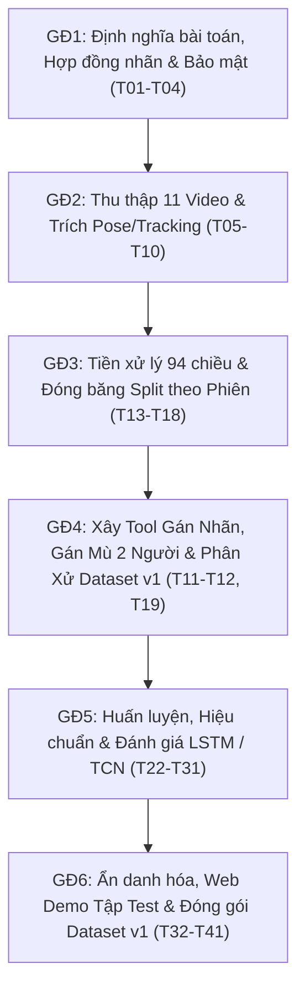

# Tài Liệu Tổng Quan Quy Trình & Kiến Trúc Dự Án — CVF25PRJ10

**Tên đề tài:** Phân tích mức độ tham gia học tập từ tín hiệu hành vi quan sát được (*Observable Learning Participation Analysis*)  
**Mã nhiệm vụ:** `CVFP26BCPPRJC012` · **Nhóm:** `CVF25PRJ10` (Vũ Văn Phong, Nguyễn Hữu Quân, Vũ Đức Tài, Nguyễn Dũng Tiến)  
**Ngôn ngữ & Stack chính:** Python 3.12/3.14, OpenCV, Ultralytics YOLOv8/YOLO11-Pose, ByteTrack, PyTorch (LSTM / TCN), scikit-learn, Pandas/PyArrow, Streamlit, Plotly, Tkinter, FFmpeg.

---

## 1. Triết lý & Giới hạn bài toán (Bắt buộc nắm trước khi đọc)

Hệ thống **chỉ ước lượng mức độ tham gia học tập quan sát được** dựa trên **chuỗi tư thế và chuyển động cơ thể theo thời gian**.

- **Hệ thống KHÔNG làm và KHÔNG kết luận:**
  - Không nhận dạng cảm xúc (vui, chán, căng thẳng), ý định, động cơ hay mức độ hiểu bài bên trong.
  - Không nhận dạng danh tính khuôn mặt (`face recognition`), không gắn tên/MSSV vào `track_id`.
- **Hợp đồng nhãn (Source of truth: [src/contracts/labels.py](file:///d:/ThiGiacMayTinh/observable-learning-engagement/src/contracts/labels.py)):**
  - **3 lớp huấn luyện (Training Target):** `HIGH_OBSERVED_PARTICIPATION`, `MODERATE_OBSERVED_PARTICIPATION`, `LOW_OBSERVED_PARTICIPATION`.
  - **Trạng thái cổng bất định (`UNCERTAIN`):** Chỉ là đầu ra của hệ thống khi đầu vào bị che khuất hoặc mô hình không đủ tự tin — **tuyệt đối không phải lớp thứ 4 để train mô hình**.
  - **Trạng thái chất lượng khi gán nhãn:** `VALID`, `OCCLUDED`, `TRANSITION`, `INVALID`.
  - **Nguồn gốc nhãn (`label_source`):** `HUMAN`, `WEAK_RULE` (bắt buộc kèm `label_rule_version`), `ADJUDICATED`.

---

## 2. Sơ đồ tổng quan toàn dự án

### 2.1. Sơ đồ luồng xử lý kỹ thuật (End-to-End Pipeline)

### 2.2. Sơ đồ các giai đoạn triển khai thực tế của nhóm (GĐ1 → GĐ6)

---

## 3. Chi tiết từng giai đoạn: Mục tiêu, Cách làm & Kết quả

### Giai đoạn 1 — Định nghĩa bài toán, Hợp đồng dữ liệu & Quy tắc bảo mật
- **Mục tiêu:** Đảm bảo cả 4 thành viên (và công cụ AI/code) dùng chung một định nghĩa nhãn, schema dữ liệu và quy chuẩn tái lập thí nghiệm, tránh mỗi người hiểu một kiểu.
- **Cách triển khai:**
  1. Soạn bộ tài liệu khung: [docs/scope.md](file:///d:/ThiGiacMayTinh/observable-learning-engagement/docs/scope.md), [docs/dataset_schema.md](file:///d:/ThiGiacMayTinh/observable-learning-engagement/docs/dataset_schema.md), [docs/annotation_guide.md](file:///d:/ThiGiacMayTinh/observable-learning-engagement/docs/annotation_guide.md), [docs/data_collection_protocol.md](file:///d:/ThiGiacMayTinh/observable-learning-engagement/docs/data_collection_protocol.md), [docs/privacy_and_consent.md](file:///d:/ThiGiacMayTinh/observable-learning-engagement/docs/privacy_and_consent.md).
  2. Code hóa hợp đồng nhãn trong [src/contracts/labels.py](file:///d:/ThiGiacMayTinh/observable-learning-engagement/src/contracts/labels.py) và hàm đọc/lưu an toàn trong [src/contracts/annotation_io.py](file:///d:/ThiGiacMayTinh/observable-learning-engagement/src/contracts/annotation_io.py) để tự động chặn lỗi lưu nhãn ngắn (`HIGH`) hoặc trộn nhầm nhãn `WEAK_RULE` thành `HUMAN`.
  3. Tạo cấu hình gốc bất biến [configs/baseline.yaml](file:///d:/ThiGiacMayTinh/observable-learning-engagement/configs/baseline.yaml) và công cụ ghi log thí nghiệm [scripts/new_experiment.py](file:///d:/ThiGiacMayTinh/observable-learning-engagement/scripts/new_experiment.py) (mỗi lần chạy lưu đủ `metadata.json`, `config.yaml`, `git_commit`, `seed`).
- **Đầu ra:** Bộ khung kiến trúc repo + script kiểm tra `scripts/check_setup.py` (**51 paths OK**).

---

### Giai đoạn 2 — Thu thập Video & Trích xuất Pose + Tracking ẩn danh
- **Mục tiêu:** Chuyển đổi video lớp học thô (`.mp4`) thành dữ liệu tọa độ khung xương theo từng cá nhân ẩn danh theo thời gian, tách biệt hoàn toàn khỏi hình ảnh khuôn mặt.
- **Cách triển khai:**
  1. Thu thập **11 video lớp học**: `session_001`–`session_006` (video dài 250–900 giây, 1920×1080 @ 30 FPS, có `metadata.json` mô tả góc quay/số người/điều kiện sáng) và `class_1`–`class_5` (clip ngắn ~15s).
  2. Dùng [src/pose/extractor.py](file:///d:/ThiGiacMayTinh/observable-learning-engagement/src/pose/extractor.py) và CLI [scripts/extract_pose.py](file:///d:/ThiGiacMayTinh/observable-learning-engagement/scripts/extract_pose.py) chạy **YOLOv8 / YOLO11-Pose** lấy mẫu ở **10 FPS**, trích xuất khung bao (`bbox`), độ tin cậy và **17 khớp xương COCO** (`nose`, `eyes`, `ears`, `shoulders`, `elbows`, `wrists`, `hips`, `knees`, `ankles`).
  3. Gắn bộ theo dõi **ByteTrack** ([src/pose/tracker.py](file:///d:/ThiGiacMayTinh/observable-learning-engagement/src/pose/tracker.py)) để gán `track_id` liên tục cho mỗi người trong từng video và gán vùng ghế lớp học 3×3 (`F/M/B × L/C/R`) qua [scripts/assign_zones.py](file:///d:/ThiGiacMayTinh/observable-learning-engagement/scripts/assign_zones.py).
- **Đầu ra:** **11 cặp file pose** (`.csv` và `.parquet`) trong [data/poses/](file:///d:/ThiGiacMayTinh/observable-learning-engagement/data/poses) (ví dụ bản Parquet nén 11 video chỉ nặng **80.35 MiB**, lưu giữ lâu dài thay cho 3 GB video thô).

---

### Giai đoạn 3 — Tiền xử lý, Kỹ thuật Đặc trưng (`posefeat-v2`) & Chia tập chống rò rỉ
- **Mục tiêu:** Biến bảng tọa độ thô có nhiễu/mất khớp thành tensor chuỗi thời gian chuẩn hóa `[N, 40, 94]` đồng nhất cho cả LSTM và TCN, đảm bảo không rò rỉ dữ liệu cùng video giữa Train và Test.
- **Cách triển khai:**
  1. **Pose Quality Gate ([src/preprocessing/quality_gate.py](file:///d:/ThiGiacMayTinh/observable-learning-engagement/src/preprocessing/quality_gate.py)):** Kiểm tra tỷ lệ khớp nhìn thấy (`min_visible_ratio >= 0.60`), độ tin cậy trung bình (`>= 0.30`). Track quá ngắn (< 2 giây) bị loại.
  2. **Cleaning & Normalization ([src/preprocessing/cleaner.py](file:///d:/ThiGiacMayTinh/observable-learning-engagement/src/preprocessing/cleaner.py)):** Nội suy khoảng đứt ngắn; chuẩn hóa tọa độ theo tâm vai/hông và **chiều dài thân (`torso`)** để không phụ thuộc học sinh ngồi bàn đầu (hình to) hay bàn cuối (hình nhỏ). Các khớp mất tuyệt đối **không** giữ nguyên `(0,0)` mập mờ mà được đánh dấu qua **17 kênh mask tường minh**.
  3. **Feature Engineering `posefeat-v2` — 94 chiều ([src/preprocessing/features.py](file:///d:/ThiGiacMayTinh/observable-learning-engagement/src/preprocessing/features.py)):**
     - `34` chiều tọa độ chuẩn hóa (`17 khớp × x, y`)
     - `34` chiều vận tốc theo thời gian ($\Delta x / \Delta t, \Delta y / \Delta t$ tại 10 FPS)
     - `6` chiều hình học tư thế: `shoulder_slope` (độ nghiêng vai), `head_proxy_x`, `head_proxy_y` (độ lệch mũi so với trung điểm vai — *làm proxy hướng đầu, không gọi là gaze*), `left_hand_raised`, `right_hand_raised` (tay cao hơn vai), `head_down` (đầu cúi thấp dưới vai)
     - `1` chiều `motion_energy` (RMS vận tốc toàn thân)
     - `2` chiều chất lượng: `visible_ratio`, `mean_keypoint_conf`
     - `17` chiều `kpt_mask_00..16` (1 = có quan sát thấy khớp, 0 = khớp bị khuyết/khuất)
  4. **Sliding Window & Frozen Split ([src/preprocessing/windows.py](file:///d:/ThiGiacMayTinh/observable-learning-engagement/src/preprocessing/windows.py), [scripts/build_dataset.py](file:///d:/ThiGiacMayTinh/observable-learning-engagement/scripts/build_dataset.py)):**
     - Cắt cửa sổ **4 giây** (`40` bước thời gian @ `10 FPS`), bước nhảy **2 giây** (trượt 50%).
     - **Đóng băng chia tập theo `session_id` (`split-v0.1`):**
       - `train` (`7` video: `session_001`, `session_002`, `class_1..5`) → **9.888** cửa sổ thô
       - `val` (`2` video: `session_003`, `session_004`) → **8.617** cửa sổ thô
       - `test` (`2` video: `session_005`, `session_006`) → **4.889** cửa sổ thô
       - **Tổng kho trích xuất:** **23.394 cửa sổ** `(23394, 40, 94)`.

---

### Giai đoạn 4 — Xây dựng Tool Gán Nhãn, Gán Mù Độc Lập 2 Người & Đóng gói `Dataset v1`
- **Mục tiêu:** Tạo bộ nhãn chuẩn do **con người thật (HUMAN / ADJUDICATED)** quan sát trực tiếp video 4 giây đánh giá độc lập, đo độ đồng thuận khoa học (Cohen's Kappa) thay cho nhãn rule tự động ban đầu.
- **Cách triển khai:**
  1. **Công cụ gán nhãn nội bộ (Web + Desktop `.exe`):**
     - Web Studio ([app/annotation_app.py](file:///d:/ThiGiacMayTinh/observable-learning-engagement/app/annotation_app.py), [app/studio_view.py](file:///d:/ThiGiacMayTinh/observable-learning-engagement/app/studio_view.py)): cắt clip 4 giây đúng `track_id` (khung vàng nổi bật người cần xem + làm tối nền xung quanh) + dải 5 ảnh diễn biến theo timestamp.
     - Desktop Native Studio ([app/desktop_studio.py](file:///d:/ThiGiacMayTinh/observable-learning-engagement/app/desktop_studio.py) + `AnnotationStudio_Desktop.exe`): giải mã khung hình thẳng vào RAM bằng OpenCV/Pillow + Tkinter để bấm phím tắt `[1-4]` / `[Enter]` **0ms không reload trang**, hỗ trợ chế độ gán nhanh ~15s cùng track ở tập train và tùy chọn bật/tắt gợi ý AI để **chấm mù**.
  2. **Rút mẫu & Gán mù độc lập 600 cửa sổ:**
     - Lấy mẫu 600 cửa sổ phân tầng (`200 train / 100 val / 300 test`), thống nhất xác minh toàn bộ pha học là `lecture`.
     - **Vũ Đức Tài** (`annotator_a.csv`) và **Vũ Văn Phong** (`annotator_b.csv`) chấm độc lập 600/600 cửa sổ.
  3. **Kiểm tra QA & Phân xử bất đồng ([scripts/dataset_qa.py](file:///d:/ThiGiacMayTinh/observable-learning-engagement/scripts/dataset_qa.py)):**
     - Kết quả đối chiếu trước phân xử (`540` cặp cùng `VALID`): đồng ý `71.48%` (`386/540`), **Cohen's Kappa = `0.4989`** tổng thể (riêng `Train = 0.6373`, `Val = 0.6282`, còn `Test = 0.2361` do Phong trên Test gần như không gán `HIGH`, lệch 56 ca với Tài ở `session_005`).
     - Nhóm rà soát lại **154 ca bất đồng `VALID`** và thống nhất dùng nhãn của Tài (`label_source=ADJUDICATED`), giữ bảo toàn `OCCLUDED` cho `46` ca cùng che + `14` ca lệch trạng thái.
  4. **Đóng gói `Dataset v1` ([scripts/package_dataset_v1.py](file:///d:/ThiGiacMayTinh/observable-learning-engagement/scripts/package_dataset_v1.py)):**
     - Xuất **600 cửa sổ chuẩn `v1`**: **`540 VALID`** (`175 train` [`72H/63M/40L`], `92 val` [`23H/53M/16L`], `273 test` [`58H/170M/45L`]) + `60 OCCLUDED`.
     - Đóng gói hoàn chỉnh không chứa video `.mp4` thô tại [data/features/dataset_v1/](file:///d:/ThiGiacMayTinh/observable-learning-engagement/data/features/dataset_v1) và file nộp [CVF25PRJ10_Dataset_v1_Submission.zip](file:///d:/ThiGiacMayTinh/observable-learning-engagement/releases/CVF25PRJ10_Dataset_v1_Submission.zip) (`76.65 MiB`, gồm 11 pose `.parquet`, `window_features.npz`, `annotations`, `metadata`, `splits`, `docs`).

---

### Giai đoạn 5 — Huấn luyện, Hiệu chuẩn & Đánh giá Mô hình Chuỗi Thời Gian
- **Mục tiêu:** Huấn luyện bộ phân loại chuỗi thời gian tự thiết kế (LSTM & TCN), xử lý mất cân bằng lớp, hiệu chuẩn xác suất và kiểm chứng trên tập Test độc lập.
- **Cách triển khai ([scripts/train.py](file:///d:/ThiGiacMayTinh/observable-learning-engagement/scripts/train.py), [scripts/evaluate.py](file:///d:/ThiGiacMayTinh/observable-learning-engagement/scripts/evaluate.py)):**
  1. **Kiến trúc tùy chỉnh (Customized Temporal Models):**
     - **ParticipationLSTM ([src/models/lstm.py](file:///d:/ThiGiacMayTinh/observable-learning-engagement/src/models/lstm.py)):** LSTM 1–2 tầng kết hợp `0.5 * (avg_pool + last_step)` qua MLP head 3 lớp.
     - **ParticipationTCN ([src/models/tcn.py](file:///d:/ThiGiacMayTinh/observable-learning-engagement/src/models/tcn.py)):** Conv1D chiếu đầu vào `94 → 64`, nối tiếp **4 tầng `CausalConvBlock`** (kernel=3, dilation=$2^0, 2^1, 2^2, 2^3 = 1, 2, 4, 8$, BatchNorm, ReLU, Dropout, Residual connection), gộp `[avg_pool, last_step]` ra head phân loại 3 lớp.
  2. **Huấn luyện chống mất cân bằng:** Dùng `CrossEntropyLoss(weight=class_weights)` tự tính nghịch đảo tần suất từ tập train, chọn checkpoint tốt nhất bằng **Val Macro-F1** với Early Stopping.
  3. **Hiệu chuẩn & Cổng bất định ([src/uncertainty/gate.py](file:///d:/ThiGiacMayTinh/observable-learning-engagement/src/uncertainty/gate.py)):**
     - Khớp hệ số nhiệt **Temperature Scaling** trên tập `val` để xác suất Softmax phản ánh đúng độ tự tin thực tế (giảm ECE).
     - Chạy `explain_uncertainty_gate`: nếu `visible_ratio < 0.60` → `UNCERTAIN (LOW_VISIBILITY)`; nếu `mean_keypoint_conf < 0.30` → `UNCERTAIN (LOW_KEYPOINT_CONF)`; nếu $\max(P) < \text{min\_probability}$ → `UNCERTAIN (LOW_MODEL_CONF)`; còn lại → `ACCEPTED`.
- **Kết quả thực nghiệm đã đo trên `Dataset v1` (`175 train / 92 val / 273 test`):**

| Mô hình | Val Macro-F1 (92) | Raw Test Macro-F1 (273) | Accepted Coverage | Accepted Macro-F1 | Accepted Accuracy |
|---|---:|---:|---|---:|---:|
| **TCN (`20261126-110817`)** | **`0.6999`** | **`0.4989`** | `77.66%` (`212/273`) | **`0.5514`** | **`61.32%`** |
| **LSTM Compact 1L-64 (`20261126-110755`)** | `0.6980` | `0.4695` | `79.85%` (`218/273`) | `0.4803` | `56.88%` |
| **LSTM 2L-128 (`20261126-110720`)** | `0.6435` | `0.3789` | `73.26%` (`200/273`) | `0.4180` | `49.00%` |

- **Bài học thực nghiệm quan trọng nhóm đã kiểm chứng:** Thử nghiệm gộp hàng nghìn nhãn sinh tự động từ các rule khác nhau (`train/val/test_full_ai_assist`) làm mô hình bị lệch phân bố nặng (train chỉ có `0.94% LOW` trong khi val có `28.1% LOW`), kéo Test Macro-F1 tụt xuống `0.28–0.31` — khẳng định chất lượng nhãn người nhất quán quan trọng hơn số lượng nhãn yếu.

---

### Giai đoạn 6 — Ẩn danh hóa, Web Demo & Xuất Báo Cáo Thống Kê
- **Mục tiêu:** Đưa toàn bộ pipeline thành sản phẩm trình diễn hoàn chỉnh trên trình duyệt web, bảo vệ quyền riêng tư người học và hỗ trợ tổng hợp theo thời gian / khu vực lớp học.
- **Cách triển khai:**
  1. **Ẩn danh & Render Video dự đoán ([src/pose/visualization.py](file:///d:/ThiGiacMayTinh/observable-learning-engagement/src/pose/visualization.py), [src/pose/anonymizer.py](file:///d:/ThiGiacMayTinh/observable-learning-engagement/src/pose/anonymizer.py)):** Làm mờ vùng đầu tự động (`apply_face_blur`), vẽ khung xương + hộp màu theo nhãn (`🟢 HIGH`, `🟡 MODERATE`, `🔴 LOW`, `⚪ UNCERTAIN`) kèm `track_id` ẩn danh, thanh HUD đếm sống `H/M/L/U`, xuất MP4 chuẩn H.264 qua `ffmpeg` ([src/pose/video_codec.py](file:///d:/ThiGiacMayTinh/observable-learning-engagement/src/pose/video_codec.py)) để phát trực tiếp trên trình duyệt.
  2. **Suy luận đầu-cuối & Demo tập Test ([scripts/predict_video.py](file:///d:/ThiGiacMayTinh/observable-learning-engagement/scripts/predict_video.py), [scripts/demo_test_video.py](file:///d:/ThiGiacMayTinh/observable-learning-engagement/scripts/demo_test_video.py)):** Cho phép chạy cả video upload hoàn toàn mới hoặc tái sử dụng pose của 2 video tập Test (`session_005`, `session_006`) để chạy mô hình + đối chiếu trực tiếp Ground Truth `Dataset v1`.
  3. **Web Dashboard ([app/streamlit_app.py](file:///d:/ThiGiacMayTinh/observable-learning-engagement/app/streamlit_app.py)):** Gồm 6 tab — nổi bật là **🎬 Demo Video Tập Test**, **Chạy suy luận** (upload MP4/CSV), **Diễn biến theo thời gian**, **Bản đồ vùng lớp 3×3 & Xuất báo cáo** (`results.csv`, `timeline.csv`, `zone_summary.csv`, `summary.json`, `summary_report.md` qua [src/reporting/exporter.py](file:///d:/ThiGiacMayTinh/observable-learning-engagement/src/reporting/exporter.py)).

---

## 4. Bảng tổng hợp Công nghệ sử dụng & Lý do lựa chọn ("Tại sao dùng?")

| Thành phần | Công nghệ đã chọn | Tại sao chọn công nghệ này (so với phương án thay thế)? |
|---|---|---|
| **Pose Extraction** | **Ultralytics YOLOv8 / YOLO11-Pose** | Phát hiện đồng thời nhiều học sinh (~15–25 người/frame) + 17 keypoints chỉ trong **1 lượt chạy** (single-stage). Nhanh và ổn định hơn OpenPose/HRNet khi chạy lớp học đông trên CPU/Colab; tránh đưa ảnh RGB thô vào model phân loại giúp **bảo vệ quyền riêng tư** và tránh học nhầm màu áo/nền phòng học. |
| **Multi-Object Tracking** | **ByteTrack** | Ghép nối cả các detection có confidence thấp ở vòng 2 bằng Kalman Filter + IoU, giữ `track_id` ổn định khi học sinh bị bàn ghế hoặc bạn trước mặt che khuất một phần. **Không dùng DeepSORT/Re-ID khuôn mặt** vì mục tiêu của đề tài cấm nhận dạng danh tính và không muốn tốn thêm mạng CNN trích đặc trưng ngoại hình. |
| **Chuẩn hóa & Đặc trưng** | **Torso Normalization + `posefeat-v2` (94 chiều + 17 mask)** | Chuẩn hóa theo độ dài thân giúp biểu diễn bất biến với góc xa/gần (bàn đầu vs bàn cuối). Thêm `17` kênh mask nhị phân giúp mạng phân biệt dứt khoát khớp bị che (`mask=0`) với tọa độ thật ở tâm `(0,0)`. Bổ sung vận tốc và góc hình học giúp mô hình dễ nhận ra cử chỉ giơ tay, cúi gục, xoay người. |
| **Temporal Classification** | **PyTorch LSTM & TCN (Causal Dilated Conv1D)** | Video hành vi cần ngữ cảnh liên tục qua nhiều giây thay vì từng ảnh rời rạc. **LSTM** mô hình hóa phụ thuộc tuần tự; **TCN** dùng tích chập giãn nở nhân quả ($d=1,2,4,8$) mở rộng trường nhìn trọn cửa sổ 40 bước, train nhanh song song và **ít overfit hơn trên tập dữ liệu vừa/nhỏ** (TCN đạt `0.5514` vs LSTM `0.4803` Accepted Macro-F1 trên `Dataset v1`). |
| **Độ tin cậy & An toàn quyết định** | **Temperature Scaling + Uncertainty Gate** | Lớp học thực tế thường xuyên có người bị che khuất hoặc tư thế trung tính nhập nhằng. Thay vì ép model đoán bừa, cổng bất định tách riêng `LOW_VISIBILITY`, `LOW_KEYPOINT_CONF`, `LOW_MODEL_CONF` thành `UNCERTAIN` để người xem biết khi nào hệ thống đáng tin (`Coverage` vs `Accepted F1`). |
| **Lưu trữ Dữ liệu & Tensor** | **Parquet (`pyarrow`) + NumPy `.npz` + CSV** | **Parquet** lưu bảng pose dạng cột nén gọn hơn CSV ~2.5× (`80.35 MB` vs `196.6 MB` cho 11 video) và load cực nhanh; **`.npz`** nén trực tiếp tensor `float32 (N,40,94)` nạp thẳng vào PyTorch `Dataset`; **CSV** dùng cho phiếu gán nhãn để người dùng dễ mở kiểm tra bằng Excel/Pandas. |
| **Tool Gán Nhãn** | **Streamlit + Desktop Tkinter/OpenCV/Pillow (`.exe`)** | Streamlit dựng nhanh giao diện web đa trang nhưng bị độ trễ rerun mỗi lần click khi gán hàng trăm cửa sổ; nhóm bổ sung bản **Tkinter Desktop Studio** giải mã clip 4s thẳng vào RAM giúp bấm gán `0ms` và đóng gói launcher `.exe` cho thành viên dùng ngay trên Windows. |
| **Web Demo & Trực quan hóa** | **Streamlit + Plotly + OpenCV + FFmpeg (`libx264`)** | Streamlit + Plotly cho phép dựng dashboard tương tác (biểu đồ cột chồng, heatmap 3×3, bảng lọc track, nút tải export bundle) chỉ bằng Python. FFmpeg chuyển mã sang chuẩn **H.264 (`yuv420p`)** vì OpenCV `mp4v` mặc định không phát được trực tiếp trong thẻ `<video>` của trình duyệt Chrome/Edge. |
| **Kiểm thử & Tái lập** | **`pytest` + YAML Config + `metadata.json` SHA-256** | Mọi thay đổi pipeline, label contract, shape đặc trưng, UI Streamlit (`AppTest`) đều được test tự động; mọi thí nghiệm đều khóa `seed`, lưu `config.yaml` snapshot và mã băm SHA-256 để bảo vệ đồ án có tính kiểm chứng cao. |
