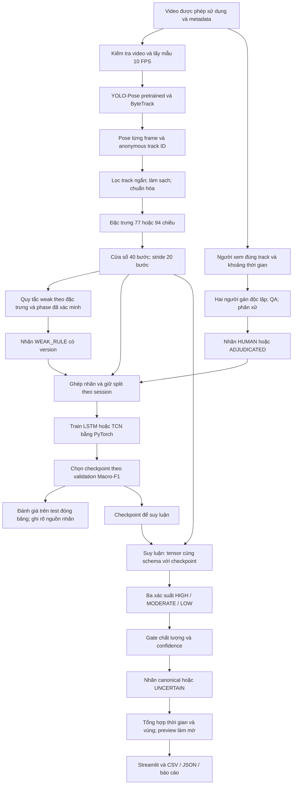
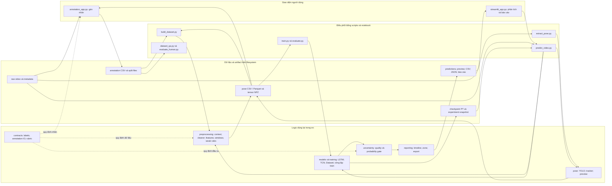

# Báo cáo phân tích dự án: quy trình dữ liệu, gán nhãn, huấn luyện và kiến trúc

**Dự án:** CVF25PRJ10 — Phân tích mức độ tham gia học tập từ tín hiệu hành vi quan sát được  
**Mã đề tài:** CVFP26BCPPRJC012  
**Ngày phân tích:** 16/11/2026  
**Cơ sở:** tài liệu, mã nguồn và artifact có trong workspace tại thời điểm đọc; bao gồm các thay đổi local chưa commit. Đây là báo cáo phân tích, không phải biên bản chạy lại huấn luyện hoặc nghiệm thu khoa học.

## Mục lục

1. Bài toán và cách hệ thống hoạt động
2. Sơ đồ luồng tổng quan
3. Sơ đồ kiến trúc tổng quan
4. Công nghệ và vai trò của từng thành phần
5. Thu thập, tổ chức và kiểm tra dữ liệu
6. Trích xuất pose, tracking và tiền xử lý
7. Gán nhãn thủ công: thao tác và tiêu chí
8. Gán nhãn quy tắc: thuật toán thực tế
9. Dữ liệu đầu vào huấn luyện
10. Kiến trúc LSTM và TCN
11. Quy trình huấn luyện và quản lý thí nghiệm
12. Đánh giá và diễn giải kết quả
13. Suy luận video mới, dashboard và xuất báo cáo
14. Quy trình chạy theo từng bước
15. Hiện trạng, hạn chế và thứ tự hoàn thiện
16. Nguồn đối chiếu mã nguồn

## 1. Bài toán và cách hệ thống hoạt động

Hệ thống nhận video, phát hiện tư thế của từng người, nối tư thế theo thời gian bằng mã theo dõi ẩn danh, rồi dùng mô hình chuỗi thời gian để ước lượng **mức độ tham gia học tập quan sát được**. Đơn vị phân tích chính là **một track của một người trong một cửa sổ khoảng 4 giây**, không phải toàn bộ lớp hoặc một ảnh riêng lẻ.

Ví dụ minh họa: video có nhiều người; hệ thống lấy track 7 trong khoảng 10,0–13,9 giây, tạo 40 vector đặc trưng, rồi dự đoán ba xác suất. Nếu chất lượng tư thế và độ tin cậy đạt ngưỡng, hệ thống xuất một nhãn; nếu không, xuất `UNCERTAIN`. Các con số trong ví dụ này chỉ giải thích cấu trúc xử lý, không phải kết quả đo mới.

### 1.1. Hai mô hình có vai trò khác nhau

| Thành phần | Đầu vào | Đầu ra | Vai trò huấn luyện trong dự án |
|---|---|---|---|
| YOLOv8-Pose pretrained | Frame màu từ video | Bounding box, 17 keypoint, confidence | Dùng trọng số có sẵn để trích tư thế; không có bằng chứng dự án huấn luyện lại YOLO |
| LSTM hoặc TCN | Chuỗi số biểu diễn pose/chuyển động | Ba logits, sau softmax thành ba xác suất | Mô hình phân loại do dự án cấu hình và huấn luyện |

Vì vậy, câu trả lời cho “train bằng dữ liệu gì?” là: **train LSTM/TCN bằng tensor đặc trưng pose/chuyển động và nhãn cửa sổ tương ứng**, không đưa trực tiếp file MP4 hay ảnh RGB vào temporal classifier.

### 1.2. Hợp đồng nhãn

| Nhãn lưu trong dữ liệu/mô hình | Chỉ số lớp | Hiển thị |
|---|---:|---|
| `HIGH_OBSERVED_PARTICIPATION` | 0 | HIGH |
| `MODERATE_OBSERVED_PARTICIPATION` | 1 | MODERATE |
| `LOW_OBSERVED_PARTICIPATION` | 2 | LOW |
| `UNCERTAIN` | Không có chỉ số huấn luyện | UNCERTAIN |

`UNCERTAIN` là trạng thái từ chối kết luận của hệ thống. Không huấn luyện nó thành lớp hành vi thứ tư. `VALID`, `OCCLUDED`, `TRANSITION`, `INVALID` là các trạng thái chất lượng/gán nhãn, cũng không phải bốn lớp để classifier học.

Hệ thống không đo trực tiếp cảm xúc, động cơ, mức hiểu bài, chú ý bên trong hoặc danh tính. LOW không có nghĩa là “lười”, “buồn chán” hoặc “mất tập trung”. Hình học đầu 2D chỉ là `head-orientation proxy`, không phải ước lượng gaze chính xác.

## 2. Sơ đồ luồng tổng quan

Sơ đồ tách nhánh chuẩn bị dữ liệu/huấn luyện và nhánh sử dụng mô hình. Hai nhánh phải dùng representation tương thích.



Nhãn weak là một phương án tạo dữ liệu khám phá. Nhánh HUMAN/ADJUDICATED là cơ sở cần có cho đánh giá độc lập. Không hiểu hai nhánh nhãn trong sơ đồ là được phép trộn tùy ý vào test chính thức.

## 3. Sơ đồ kiến trúc tổng quan

Kiến trúc hiện tại là ứng dụng Python theo module và file artifact. Không có bằng chứng cần triển khai microservice, message queue hoặc cơ sở dữ liệu máy chủ để vận hành baseline.



**Nguyên tắc phân tầng:** UI hiển thị và điều phối; `scripts/` cung cấp CLI; `src/` chứa thuật toán dùng lại; `configs/` chứa cấu hình; `data/`, `models/`, `reports/` lưu artifact. Notebook Colab gọi cùng code, không phải một codebase huấn luyện riêng.

## 4. Công nghệ và vai trò của từng thành phần

| Công nghệ/định dạng | Cách dự án sử dụng |
|---|---|
| Python | Ngôn ngữ điều phối, xử lý dữ liệu và mô hình |
| OpenCV | Đọc video, xử lý frame, vẽ tư thế, tạo preview |
| Ultralytics | Nạp YOLO-Pose và gọi detection/tracking |
| YOLOv8n-Pose | Pose extractor trong baseline chính thức |
| YOLO11m-Pose | Biến thể extractor cho demo ngoài split; không thay baseline ngầm |
| ByteTrack | Tracker baseline qua Ultralytics; duy trì track ID qua các frame |
| BoT-SORT | Phương án so sánh tracker; chưa có đủ ground truth đánh giá ID switch |
| NumPy | Vector đặc trưng, tensor trước PyTorch, lưu NPZ |
| pandas, PyArrow | CSV/Parquet, ghép metadata, thống kê, quản lý bảng cửa sổ |
| PyTorch | `nn.LSTM`, `nn.Conv1d`, DataLoader, autograd, Adam, loss, checkpoint |
| YAML/PyYAML | Cấu hình baseline và thí nghiệm |
| Streamlit | Giao diện gán nhãn và dashboard suy luận |
| Plotly/Matplotlib | Biểu đồ tương tác hoặc biểu đồ báo cáo |
| pytest | Kiểm thử các hợp đồng và luồng xử lý |
| imageio-ffmpeg | Hỗ trợ codec video/preview trong môi trường ứng dụng |
| Google Colab | Môi trường tùy chọn để chạy notebook; không bắt buộc và không đồng nghĩa đã benchmark GPU |

Phiên bản dependency được khai báo trong `requirements.txt`; báo cáo này không cài lại hoặc xác nhận lại tất cả phiên bản trên máy. Khi tái lập, phải kiểm tra `docs/ENVIRONMENT.md`, môi trường thực tế và config snapshot của run.

## 5. Thu thập, tổ chức và kiểm tra dữ liệu

### 5.1. Đầu vào cần chuẩn bị

1. Video được phép sử dụng, ưu tiên camera cố định, 1080p, 25–30 FPS.
2. Metadata xác định session, camera, thời điểm, độ phân giải, điều kiện ánh sáng và quyền sử dụng.
3. Timeline hoạt động thực tế: `lecture`, `individual_work`, `discussion`; ghi khoảng bắt đầu/kết thúc và căn cứ xác minh.
4. Sơ đồ vùng lớp học và cấu hình gán zone theo góc camera.
5. Danh sách session thuộc train/validation/test đã đóng băng.

Pilot theo protocol dự kiến 6–10 người, 10–15 phút. Mục tiêu dataset trong kế hoạch là ít nhất 15 người, 6 session và 90 phút usable. Đây là **mục tiêu nghiệm thu**, không phải số liệu đã chứng minh đạt.

### 5.2. Tổ chức lưu trữ

```text
data/raw/<session>/cam_A.mp4                 video riêng tư
data/raw/<session>/metadata.json             ngữ cảnh, camera, phase timeline
data/poses/<session>_poses.csv               tư thế và tracking
data/annotations/<review_set>/annotator_a.csv
data/annotations/<review_set>/annotator_b.csv
data/annotations/<approved_set>/adjudicated.csv
data/splits/train_sessions.txt
data/splits/val_sessions.txt
data/splits/test_sessions.txt
data/features_<version>/participation_windows.csv
data/features_<version>/window_features.npz
models/checkpoints/<experiment_id>.pt
reports/experiments/<experiment_id>/...
```

Không đưa video thô có người thật lên repository công khai. Track ID không được nối thành bảng tên/MSSV. Metadata consent có sẵn trong file là thông tin khai báo, không thay thế việc xác minh quyền sử dụng và quyền công bố.

### 5.3. Kiểm tra độc lập của split

Các file split đang có:

| Split | Session |
|---|---|
| Train | `class_1`, `class_2`, `class_3`, `class_4`, `class_5`, `session_001` |
| Validation | `session_002`, `session_003`, `session_004` |
| Test | `session_005`, `session_006` |

Builder kiểm tra tên session không trùng giữa các split, không thiếu session, không có session không tồn tại; ghi hash file split. Tuy nhiên, **khác tên session chưa đủ chứng minh độc lập nguồn video/người**. Nếu nhiều session được cắt từ một video gốc hoặc cùng người xuất hiện ở các tập, phải kiểm tra `source_recording_id`, ngày quay và nguồn dữ liệu. Audit ngày 09/11 còn ghi nguồn độc lập chưa xác minh.

Không random các cửa sổ chồng lấn của cùng video vào train và test. Với cửa sổ 4 giây, stride 2 giây, hai cửa sổ liên tiếp chia sẻ khoảng một nửa dữ liệu, nên random window rất dễ gây leakage.

## 6. Trích xuất pose, tracking và tiền xử lý

### 6.1. Lấy mẫu và trích tư thế

OpenCV đọc video; extractor lấy frame theo timestamp với mục tiêu 10 FPS trong baseline. `frame_idx` lưu chỉ số frame đã lấy mẫu, không phải chỉ số frame video thô. `timestamp_ms` giữ thời gian tương ứng trong video.

YOLO-Pose trả bounding box và 17 điểm COCO: mũi; mắt trái/phải; tai trái/phải; vai trái/phải; khuỷu tay trái/phải; cổ tay trái/phải; hông trái/phải; gối trái/phải; cổ chân trái/phải. Mỗi điểm có `(x, y, confidence)`.

Khi bật tracking, code gọi `model.track(..., persist=True, tracker=...)`. ByteTrack nối detection qua thời gian. ID chỉ có ý nghĩa trong session/camera; mất dấu hoặc che khuất có thể gây đứt track, đổi ID. Không coi số track là số người thật duy nhất.

Mỗi dòng pose gồm khóa session/camera/frame/time/track, bbox, 51 giá trị keypoint, `visible_ratio`, `mean_keypoint_conf`, `zone_id`. Với confidence keypoint dưới ngưỡng hoặc tọa độ `(0,0)`, tọa độ được đánh dấu NaN. `visible_ratio` là số điểm hợp lệ chia 17; mean confidence trong extractor là trung bình confidence trên 17 điểm.

### 6.2. Chất lượng và làm sạch

Baseline khai báo:

| Thông số | Giá trị | Ý nghĩa |
|---|---:|---|
| Pose confidence threshold | 0,30 | Ngưỡng dùng trong trích pose |
| Track tối thiểu | 2 giây | Lọc track quá ngắn trước dựng chuỗi |
| Mean visible ratio của window | 0,60 | Dưới ngưỡng: chất lượng không đạt |
| Mean keypoint confidence của window | 0,30 | Dưới ngưỡng: chất lượng không đạt |
| Cửa sổ temporal | 4 giây | Cần 40 bước ở 10 FPS |
| Stride | 2 giây | Dịch 20 bước giữa hai cửa sổ |

Track đạt 2 giây chưa chắc tạo được cửa sổ: vẫn phải có đủ 40 bước liên tục cho window 4 giây.

`clean_and_normalize_poses` lọc track ngắn, nội suy khoảng thiếu ngắn (mặc định tối đa 3 mẫu), làm mượt moving average cửa sổ 3 mẫu, rồi chuẩn hóa. Không bật tùy tiện tùy chọn điền hết điểm thiếu vì nó có thể làm dữ liệu có vẻ quan sát được dù thực tế không thấy.

Chuẩn hóa torso dùng tâm hai vai khi có, fallback sang tâm bbox; scale lấy khoảng thân đến hông khi có, fallback kết hợp khoảng vai và chiều cao bbox, với giới hạn dưới để tránh chia cho số quá nhỏ. Công thức cơ bản:

```text
x_norm = (x - center_x) / body_scale
y_norm = (y - center_y) / body_scale
```

Mục đích là giảm ảnh hưởng vị trí trong ảnh và kích thước người. Nó không khử hoàn toàn góc nhìn, che khuất hay phối cảnh.

### 6.3. Kiểm tra liên tục theo thời gian

Builder hiện nhóm theo session + camera + track. Cửa sổ bị bỏ nếu frame lấy mẫu không liên tiếp hoặc khoảng timestamp quá lớn (trên 1,5 lần chu kỳ lấy mẫu). Cửa sổ chứa nhiều phase được đánh dấu `TRANSITION`. Phase chưa xác minh được giữ `UNKNOWN`; weak labeler không tạo nhãn khi không biết phase.

Điều này giải thích vì sao dữ liệu dựng lại với code mới có thể ít cửa sổ hơn baseline lịch sử. Không thể mặc định chạy lại code hiện tại sẽ tạo chính xác tensor của run cũ.

## 7. Gán nhãn thủ công: thao tác và tiêu chí

### 7.1. Gán nhãn cái gì?

Một dòng nhãn ứng với khóa:

```text
session_id + camera_id + track_id + t_start_ms + t_end_ms
```

`window_id` giúp nối dòng nhãn với tensor. Người gán xem toàn bộ đoạn video của đúng track, xác minh hoạt động lớp, rồi ghi chất lượng, bằng chứng và nhãn. Không khoanh bounding box mới ở bước này: tool đã dùng tọa độ tracking để chỉ đúng người cần quan sát.

### 7.2. Chuẩn bị phiếu

`scripts/sample_annotation_subset.py` lấy mẫu từ bảng cửa sổ để tạo phiếu. Theo runbook hiện tại, bộ review chính `human_review_v0_2` có 600 cửa sổ/người (200 train, 100 val, 300 test); bộ bổ sung `external_review_20261109` có 130 cửa sổ/người. Đây là số phiếu được chuẩn bị theo tài liệu, không khẳng định đã gán xong.

Hai người gán phải xem các cửa sổ tương ứng để so sánh, nhưng **không xem nhãn của nhau, nhãn weak hoặc kết quả mô hình** trước khi hoàn thành vòng độc lập.

### 7.3. Các bước thao tác trên giao diện

1. Tại thư mục gốc dự án, chạy `python -m streamlit run app/annotation_app.py --server.port 8502`.
2. Mở địa chỉ local được Streamlit hiển thị; chọn đúng người gán và bộ review.
3. Chọn cửa sổ chưa gán. Kiểm tra session, camera, track ID và mốc thời gian.
4. Xem clip có khung vàng và vùng phóng to chỉ người cần gán. Nếu ID bám sang người khác, chọn INVALID và mô tả lỗi.
5. Xem thêm ngữ cảnh video gốc tại máy local nếu cần xác minh nhiệm vụ. Không dùng phase tự sinh cũ làm bằng chứng.
6. Ghi bằng chứng trong bốn khoảng thời gian và căn cứ xác định phase theo rubric pilot.
7. Chọn trạng thái chất lượng; nếu VALID, chọn nhãn khớp tiêu chí, nhập mô tả hành vi và độ tin cậy.
8. Xác nhận đã xem đúng người, bấm **Lưu và đến cửa sổ chưa gán tiếp** hoặc **Lưu tại cửa sổ này**.
9. Tải CSV phiếu của mình khi bàn giao. Chuyển cửa sổ khi chưa lưu có thể mất phần nhập chưa gửi.

Theo runbook, Quân dùng `annotator_a.csv`, Phong dùng `annotator_b.csv`. Chọn tên chỉ phục vụ provenance, không phải đăng nhập/phân quyền. Không đưa giao diện chứa video gốc ra Internet chỉ để gán nhãn từ xa.

### 7.4. Phân biệt hướng dẫn v0.2 và rubric v0.3-pilot

**v0.2** diễn giải HIGH là nhiều tín hiệu phù hợp với hoạt động; MODERATE là tín hiệu yếu/không liên tục; LOW là nhiều tín hiệu không phù hợp trong phần lớn cửa sổ.

**v0.3-pilot** đang được tool hỗ trợ, yêu cầu bằng chứng thời gian rõ hơn. Đây là đề xuất cần nhóm thử nghiệm/thống nhất, chưa thay thế ngầm scope hoặc toàn bộ nhãn v0.2. Đặc biệt MODERATE trong rubric mới hẹp hơn. Khi dùng để xây dataset chính thức, phải rà soát khác biệt và đóng băng version, không trộn hai định nghĩa mà không xử lý.

Với rubric pilot, chia cửa sổ thành bốn khoảng gần bằng nhau; mỗi khoảng ghi:

| Mã | Cách hiểu |
|---|---|
| ALIGNED | Thấy rõ hành vi phù hợp nhiệm vụ thực tế đã xác minh |
| CONTRADICTORY | Thấy rõ hành vi mâu thuẫn nhiệm vụ; có bằng chứng cụ thể |
| AMBIGUOUS | Thấy người nhưng chưa xác định được phù hợp hay không |
| UNOBSERVABLE | Che khuất hoặc không xác định đúng người |

Ánh xạ thí điểm khi phase đã xác minh và trạng thái VALID:

| Bằng chứng bốn khoảng | Nhãn được phép |
|---|---|
| Ít nhất 3 ALIGNED | HIGH_OBSERVED_PARTICIPATION |
| Ít nhất 3 CONTRADICTORY | LOW_OBSERVED_PARTICIPATION |
| Ít nhất 3 khoảng rõ, nhưng không bên nào đạt 3 | MODERATE_OBSERVED_PARTICIPATION |
| Ít hơn 3 khoảng rõ | Không gán ba mức; chọn trạng thái và ghi nguyên nhân |

Ngưỡng 3/4 là lựa chọn vận hành đề xuất của dự án, không phải ngưỡng khoa học đã kiểm chứng. Việc tool kiểm tra nhãn có khớp bằng chứng người nhập không không biến dòng đó thành nhãn do mô hình tạo.

### 7.5. Ví dụ minh họa quyết định của người gán

| Tình huống | Xử lý đúng |
|---|---|
| Làm bài cá nhân; thấy giấy và tay viết đúng nhiệm vụ trong 3/4 khoảng | Có thể HIGH theo pilot nếu đủ chất lượng |
| Cúi đầu nhưng không thấy tay/tài liệu và chưa biết nhiệm vụ | Không tự gán LOW hoặc READING_WRITING |
| Thảo luận đã xác minh; quay sang nhóm, có cử chỉ phù hợp | Có thể ALIGNED; quay đầu không tự là LOW |
| 2 ALIGNED + 1 CONTRADICTORY + 1 AMBIGUOUS | MODERATE theo pilot nếu không có lý do chất lượng/transition ưu tiên |
| Người bị che phần lớn đoạn | OCCLUDED; nhãn tham gia để trống |
| Cửa sổ cắt qua thay đổi hoạt động rõ | TRANSITION; không ép ba lớp |
| Không biết nhiệm vụ hoặc tracker đổi người | INVALID; ghi nguyên nhân |

### 7.6. Dữ liệu phải lưu

CSV chứa khóa cửa sổ; `class_phase`; `atomic_behavior`; `participation_label`; `annotation_state`; `label_source`; `label_rule_version`; `annotation_guide_version`; `annotation_confidence`; `occlusion_level`; `zone_id`; `annotator_id`; `notes`. Tool pilot còn lưu `annotation_evidence` và `phase_evidence`.

Với VALID do người trực tiếp gán: `label_source=HUMAN`, rule version trống. Nhãn sau phân xử: `ADJUDICATED`, rule version trống. Với OCCLUDED/TRANSITION/INVALID: nhãn tham gia, nguồn nhãn và rule version để trống. Confidence của annotator không phải xác suất do mô hình dự đoán.

### 7.7. Kiểm tra đồng thuận và phân xử

Hai annotator gán độc lập tối thiểu 15–20% subset theo kế hoạch; tool hiện cho phép chuẩn bị cùng toàn bộ subset cho cả hai. Chạy schema QA và `--strict-human`, không dùng nhãn weak để tính đồng thuận người. Cohen’s kappa được hiểu là:

```text
kappa = (tỷ lệ đồng ý quan sát - tỷ lệ đồng ý kỳ vọng do phân bố nhãn)
        / (1 - tỷ lệ đồng ý kỳ vọng)
```

Ngưỡng `--min-kappa 0.60` trong quy trình là tiêu chí review, chưa phải kết quả đã đạt. Cần báo số cặp hợp lệ, phân bố nhãn, tỷ lệ không gán được và bất đồng trạng thái/phase; Kappa cao trên ít mẫu dễ không chứng minh dataset hoàn chỉnh.

Người phân xử xem lại video và bằng chứng, tạo bộ ADJUDICATED, ghi người/ngày/version/hash. Không sao chép dự đoán thành ground truth. Không đưa cả hai phiếu bất đồng chưa phân xử vào builder rồi trông chờ code chọn “đúng”: loader hiện ưu tiên ADJUDICATED, sau đó khử trùng theo window ID, không tự phân xử nội dung bất đồng.

## 8. Gán nhãn quy tắc: thuật toán thực tế

Kho mã có **hai đường sinh nhãn heuristic khác nhau**. Chúng cùng dùng tên version `weak-v0.1` nhưng không cùng thuật toán. Muốn truy vết cần ghi cả entry point, code revision, representation và config; riêng chuỗi version chưa đủ phân biệt.

### 8.1. Đường A — script tạo annotation CSV từ pose pixel

Nguồn: `scripts/generate_annotations.py`, hàm `analyze_track_interval`.

Script chia track thành các đoạn mục tiêu 4 giây, bước dịch mặc định 2 giây; chỉ xét đoạn có ít nhất 5 dòng pose. Đoạn cuối có thể ngắn hơn 4 giây, nên số annotation không bằng số tensor window cố định.

Quy tắc chạy theo thứ tự, điều kiện khớp trước trả kết quả trước:

| Thứ tự | Điều kiện trong mã nguồn | Kết quả |
|---:|---|---|
| 1 | Mean visible ratio < 0,40 hoặc mean confidence < 0,35 | OCCLUDED; không có nhãn |
| 2 | Cổ tay cao hơn vai ít nhất 15 pixel trong >35% các dòng có tọa độ hợp lệ, ở một trong hai tay | HAND_RAISED → HIGH |
| 3 | Trung bình trị tuyệt đối độ lệch ngang mũi so với trung điểm mắt >25 pixel | PEER_ORIENTED → LOW |
| 4 | Khoảng dọc từ mũi tới trung điểm vai <20 pixel trong >60% mẫu hợp lệ | HEAD_DOWN → LOW |
| 5 | Khoảng trên <45 pixel trong >50% mẫu hợp lệ | READING_WRITING → MODERATE |
| 6 | Không rơi vào các nhánh trên | BOARD_OR_INSTRUCTOR_FACING → HIGH |

Script đặt phase mặc định `lecture`, chuyển thành `individual_work` nếu behavior là READING_WRITING. Đây là phase suy ra từ heuristic, **không phải ngữ cảnh được người xác minh**. Script còn gán các giá trị confidence cố định như 0,92 hoặc 0,85; đó không phải độ đúng đã đo hoặc xác suất đã calibration.

Hạn chế: các ngưỡng pixel phụ thuộc độ phân giải và khoảng cách camera; fallback HIGH không bảo đảm thật sự thấy hướng bảng; quay sang bạn có thể phù hợp discussion; cúi đầu có thể đang viết. Đường này chỉ tạo weak annotations, không đáp ứng yêu cầu nhãn người độc lập.

### 8.2. Đường B — quy tắc trên tensor dùng trong builder

Nguồn: `src/preprocessing/weak_labels.py`, được `scripts/build_dataset.py` gọi. Builder không mặc nhiên lấy CSV của script A làm nhãn đích; nó tạo weak label trực tiếp từ tensor của từng cửa sổ, rồi mới ghép/ghi đè nhãn người khi chọn chế độ phù hợp.

Đầu tiên yêu cầu `quality_state=VALID` và phase thuộc lecture/individual_work/discussion. Phase UNKNOWN không được gán weak; wrapper đặt trạng thái INVALID và reason UNKNOWN_PHASE.

Ký hiệu trong bảng: `mean(...)` lấy trung bình theo các bước thời gian; tỷ lệ điều kiện đúng là trung bình của mảng boolean. Các đại lượng hình học ở đây dùng tọa độ đã chuẩn hóa, không phải pixel.

| Ưu tiên/phase | Điều kiện thực tế | Nhãn |
|---|---|---|
| Đầu tiên, mọi phase hợp lệ | Ít nhất 5 bước có tay trái hoặc phải cao hơn vai >0,05 | HIGH |
| individual_work | Tỷ lệ head_down >0,02 lớn hơn 50% và mean motion >0,01 | HIGH |
| individual_work, nếu nhánh trên không khớp | Tỷ lệ head_down >0,30 lớn hơn 80% và mean motion <0,005 | LOW |
| individual_work còn lại | Không khớp trên | MODERATE |
| lecture | Tỷ lệ head_down >0,25 lớn hơn 70% | LOW |
| lecture, tiếp theo | Tỷ lệ abs(head_proxy_x) >0,45 lớn hơn 60% | LOW |
| lecture, tiếp theo | Tỷ lệ abs(head_proxy_x) <0,25 >70%, đồng thời tỷ lệ head_down <0,15 >70% | HIGH nếu mean motion >0,015; ngược lại MODERATE |
| discussion | Mean motion >0,02 | HIGH |
| discussion, tiếp theo | Mean motion <0,005 và tỷ lệ head_down >0,20 >50% | LOW |
| discussion còn lại hoặc fallback chung | Không khớp các nhánh trên | MODERATE |

Năm bước tương ứng khoảng 0,5 giây ở 10 FPS; số 5 đang hard-code, không tự thích ứng khi đổi FPS. Comment nhánh giơ tay nói lecture/discussion nhưng điều kiện thực thi nằm trước các nhánh phase nên áp dụng cả individual_work. Báo cáo này mô tả logic thực thi.

Một số tên rule/comment cũ có từ gợi suy luận như “sleeping”, “listening”, “disengaged”. Không được dùng những tên này làm kết luận khoa học: code chỉ kiểm tra hình học và chuyển động, không xác nhận ngủ, nghe giảng hay trạng thái bên trong.

### 8.3. Weak label khác model prediction thế nào?

| Loại | Ai tạo? | Có học tham số từ dataset? | Cách sử dụng |
|---|---|---|---|
| HUMAN | Người xem video độc lập | Không | Nhãn quan sát theo guide |
| ADJUDICATED | Người phân xử có bằng chứng | Không | Nhãn đã review |
| WEAK_RULE | Điều kiện if/else trên pose/features | Không | Nhãn yếu cho thử nghiệm/hỗ trợ quy trình |
| Prediction LSTM/TCN | Mạng neural đã train | Có | Ước lượng khi suy luận; không tự thành ground truth |

Khi train và test đều dùng nhãn do cùng bộ rule tạo, điểm cao chủ yếu chứng minh mô hình tái tạo được rule. Nó chưa chứng minh mô hình phù hợp đánh giá độc lập của người hoặc khái niệm tham gia học tập trong thực tế.

## 9. Dữ liệu đầu vào huấn luyện

### 9.1. Một vector đặc trưng gồm gì?

`posefeat-v1` có 77 chiều ở mỗi frame lấy mẫu:

| Chỉ số zero-based | Nhóm | Số chiều | Cách tính |
|---|---|---:|---|
| 0–33 | Tọa độ chuẩn hóa của 17 điểm | 34 | x/y mỗi điểm |
| 34–67 | Vận tốc các tọa độ | 34 | Sai phân tọa độ chia dt = 1/sample_fps |
| 68 | Shoulder slope | 1 | atan2 độ lệch y/x hai vai |
| 69–70 | Head proxy x/y | 2 | Mũi trừ trung điểm vai |
| 71–72 | Độ cao tay trái/phải | 2 | max(0, y_vai - y_cổ_tay) |
| 73 | Head-down proxy | 1 | max(0, y_mũi - y_trung_điểm_vai) |
| 74 | Motion energy | 1 | RMS của 34 vận tốc |
| 75 | Visible ratio | 1 | Chất lượng quan sát |
| 76 | Mean keypoint confidence | 1 | Chất lượng pose |
| | **Tổng v1** | **77** | |

`posefeat-v2` nối thêm 17 mask vào vị trí 77–93, tổng 94 chiều. Mask được tính từ tọa độ chuẩn hóa hữu hạn trước bước thay NaN bằng 0 trong feature extractor. Sau tiền xử lý, mask này không đồng nghĩa hoàn toàn với “detector đã trực tiếp nhìn thấy ở frame gốc”, vì nội suy/làm mượt có thể đã tạo giá trị hữu hạn.

Code feature hiện thay NaN bằng 0 để mạng nhận số hữu hạn. v1 không có mask tường minh; v2 làm sự thiếu dữ liệu dễ nhận biết hơn. Không tuyên bố v1 phân biệt hoàn hảo giữa điểm thiếu và tọa độ thật bằng 0. Vận tốc được tính sau điền số nên thay đổi mất/xuất hiện keypoint có thể tạo motion giả; cần kiểm tra trong ablation/quality QA.

Các feature đề xuất trong tài liệu như góc khuỷu, gia tốc hoặc posture stability riêng không phải tất cả đã có kênh riêng trong tensor hiện hành. Bảng trên phản ánh đúng 77 chiều đang triển khai.

### 9.2. Tensor X và nhãn y

```text
X: float32, shape [N, T, F]
N = số cửa sổ
T = 40 bước ở baseline 4 giây × 10 FPS
F = 77 với v1 hoặc 94 với v2

y: int64, shape [N]
0 = HIGH_OBSERVED_PARTICIPATION
1 = MODERATE_OBSERVED_PARTICIPATION
2 = LOW_OBSERVED_PARTICIPATION
-1 = không có nhãn; Dataset loại khỏi train/evaluation có giám sát

Một batch baseline: X_batch [32, 40, 77], y_batch [32]
Đầu ra model: logits [32, 3]
```

Window gồm mẫu tại 0,0; 0,1; …; 3,9 giây có 40 bước dù chênh lệch timestamp đầu/cuối là 3,9 giây. Vì vậy tool có thể hiển thị 10,0–13,9 giây cho cửa sổ danh nghĩa 4 giây.

`class_phase`, zone, camera, track ID, annotation confidence và tên người gán là metadata; **không được nối vào 77/94 chiều hiện tại**. Phase ảnh hưởng sinh nhãn weak và cách người đánh giá, nhưng LSTM/TCN hiện không nhận trực tiếp phase. Đây là hạn chế quan trọng: một tư thế có thể phù hợp ở phase này nhưng không phù hợp ở phase khác, trong khi model chưa có kênh ngữ cảnh đó.

### 9.3. File NPZ và bảng metadata

`window_features.npz` chứa `X_train`, `y_train`, `X_val`, `y_val`, `X_test`, `y_test`, `all_features`, `all_labels`, các window ID, feature schema, dataset version, split version và sample FPS.

`participation_windows.csv`/Parquet chứa khóa cửa sổ, thời gian, phase, zone, quality, nhãn, nguồn nhãn, rule version và split. Khi đọc NPZ trực tiếp để train, phải lưu kèm bảng này để kiểm toán provenance: NPZ không chứa đầy đủ mọi cột nhãn người.

### 9.4. Ba chế độ build dataset

| Chế độ | Hành vi thực tế | Cách dùng |
|---|---|---|
| `--labels weak` | Gán bằng rule từ tensor | Thử nghiệm weak supervision, ghi rõ phạm vi metric |
| `--labels human` | Ghép HUMAN/ADJUDICATED theo window_id; giữ các window khớp nhãn người | Dùng bộ đã QA và phân xử; kiểm tra quality/provenance sau build |
| `--labels hybrid` | Nhãn người ghi đè ở nơi khớp; còn lại giữ weak | Không mặc định bảo đảm test chỉ có nhãn người |

Builder hiện vẫn dựng weak label trước khi ghép nhãn người. Hàm ghép chủ yếu thay label/source/rule version, không đồng bộ toàn bộ `quality_state`, phase, guide version hoặc evidence từ phiếu. Vì vậy cần audit tính nhất quán sau build, nhất là cửa sổ trước đó UNKNOWN_PHASE/INVALID. `--labels human` là công cụ nối dữ liệu, chưa thay thế nghiệm thu schema/ngữ cảnh.

`--labels hybrid` không có nghĩa “weak chỉ ở train”: cần lọc/kiểm tra riêng nguồn nhãn của val/test trước đánh giá chính thức. Không đưa một thư mục lẫn phiếu chưa phân xử vào làm nguồn nhãn chuẩn.

## 10. Kiến trúc LSTM và TCN

### 10.1. LSTM baseline

```text
[B, 40, F]
  → LSTM 2 tầng, hidden_size=128, một chiều mặc định
  → chuỗi hidden [B, 40, 128]
  → mean theo thời gian và hidden bước cuối
  → 0,5 × (mean + last), shape [B, 128]
  → Dropout 0,30
  → Linear 128→64 → ReLU → Dropout 0,30 → Linear 64→3
  → logits [B, 3]
```

LSTM dùng trạng thái ẩn/cell state để học diễn biến chuỗi. Việc kết hợp trung bình và bước cuối cho phép tận dụng toàn cửa sổ và thông tin ở cuối đoạn. Trong `forward`, code xuất logits; CrossEntropyLoss nhận logits trực tiếp. Softmax dùng khi cần xác suất suy luận. Comment trong file có nhắc layer norm nhưng head thực thi không có LayerNorm; không đưa thành phần đó vào mô tả kiến trúc.

### 10.2. TCN so sánh

Config `configs/experiments/tcn_baseline.yaml` dùng hidden 64, 4 level, kernel 3, dropout 0,20.

```text
[B, 40, F] → transpose [B, F, 40]
  → Conv1d 1×1 chiếu F→64
  → 4 block dilation 1, 2, 4, 8
     mỗi block: Conv1d + cắt padding phải + BatchNorm1d
                + ReLU + Dropout + residual
  → nối mean pooling và bước cuối: [B, 128]
  → Linear 128→64 → ReLU → Dropout → Linear 64→3
```

Convolution được padding/cắt để không lấy mẫu tương lai trong phép tích chập. Tuy nhiên, BatchNorm khi train và pooling toàn cửa sổ nghĩa là không nên tuyên bố cả hệ thống đã là pipeline streaming online nhân quả được kiểm chứng. Inference hiện phân loại cửa sổ hoàn chỉnh; preprocessing cũng có thao tác nhìn lân cận thời gian.

TCN và LSTM phải được so trên cùng feature schema, split, nguồn nhãn, cách gate và điều kiện đo. Đổi extractor hoặc feature version đồng thời với model làm việc quy kết cải thiện cho riêng kiến trúc không còn chắc chắn.

## 11. Quy trình huấn luyện và quản lý thí nghiệm

### 11.1. Trình tự thực thi của `scripts/train.py`

1. Đọc YAML và tham số CLI, đặt seed cho Python/NumPy/PyTorch.
2. Chọn thiết bị: CLI chỉ định, nếu không thì CUDA khi khả dụng, còn lại CPU.
3. Nạp NPZ; tạo `WindowFeatureDataset`; loại các dòng có `y < 0`.
4. Từ chối nếu train, val hoặc test không còn mẫu có nhãn.
5. Tạo DataLoader, shuffle train; val/test không shuffle.
6. Dựng LSTM hoặc TCN theo config và số chiều đầu vào.
7. Tính class weight từ tập train, tạo weighted CrossEntropyLoss và Adam.
8. Tạo experiment ID, snapshot cấu hình effective và metadata.
9. Mỗi epoch: forward, loss, backward, optimizer step; đánh giá validation.
10. Lưu checkpoint khi validation Macro-F1 tăng; dừng khi hết patience.
11. Nạp checkpoint tốt nhất rồi đánh giá test; lưu lịch sử, metric và hash checkpoint.

### 11.2. Hyperparameter baseline

| Thông số | Giá trị |
|---|---:|
| Seed | 42 |
| Batch size | 32 |
| Learning rate | 0,001 |
| Optimizer thực thi | Adam |
| Maximum epochs mặc định CLI | 30 |
| Early stopping patience | 10 |
| Tiêu chí chọn checkpoint | Validation Macro-F1 cao nhất |
| Loss thực thi | CrossEntropyLoss có class weight |

Class weight được tính `N_train / (3 × max(n_class, 1))`. Lớp ít mẫu được tăng trọng số. Nếu lớp vắng hoàn toàn thì trọng số không thể tạo thêm dữ liệu; vẫn cần báo thiếu lớp.

Trong training script hiện tại, Adam và weighted CE được khởi tạo trực tiếp. Chỉ đổi tên optimizer trong YAML không tự chuyển thuật toán; chưa có đầy đủ thí nghiệm không trọng số so với có trọng số. Số epoch chạy thực tế có thể ít hơn 30 do early stopping hoặc override CLI.

### 11.3. Artifact cần giữ

| Artifact | Mục đích |
|---|---|
| `metadata.json` | Experiment ID, seed, git commit, dataset/split version, config hash |
| `config.yaml` | Snapshot effective, bao gồm override được script ghi nhận |
| `training_history.csv` | Train loss/accuracy và validation metric từng epoch |
| `metrics.json` | Best epoch, metric test, class counts, đường dẫn/hash checkpoint |
| `<experiment_id>.pt` | State dict, optimizer state và thông tin dựng kiến trúc |
| `evaluation_report.json`, `predictions.csv` | Đánh giá có gate và kết quả từng window từ bước evaluate |

`train.py` tự gọi cơ chế `create_experiment` của `new_experiment.py`; không cần tạo trước một thư mục experiment khác rồi cho rằng train sẽ tự dùng nó. Với thay đổi hyperparameter, tạo config ở `configs/experiments/`, không sửa baseline liên tục.

Git commit không mô tả đủ các thay đổi chưa commit. Muốn tái lập run quan trọng từ workspace hiện tại phải chốt revision hoặc lưu patch/source manifest và hash dữ liệu tương ứng, ngoài metadata mà code đã ghi.

## 12. Đánh giá và diễn giải kết quả

### 12.1. Các phép đo cần có

| Phép đo | Câu hỏi trả lời |
|---|---|
| Macro-F1 | Trung bình F1 của ba lớp, giảm việc lớp đông lấn át |
| Precision/Recall/F1 từng lớp | Mô hình nhầm lớp nào, bỏ sót lớp nào |
| Balanced accuracy | Trung bình recall các lớp |
| Confusion matrix | Luồng nhầm giữa nhãn thật và nhãn dự đoán |
| Coverage | Bao nhiêu mẫu được hệ thống chấp nhận kết luận |
| Accepted metrics | Chất lượng trên tập còn lại sau gate |
| Uncertain rate | Tỷ lệ bị từ chối bởi gate |
| Metric theo session/zone | Tính ổn định theo bối cảnh; luôn kèm N và pose quality |

Không dùng test để chọn số epoch, window, threshold hoặc sửa rubric nhằm tăng điểm. Threshold 0,60 hiện là baseline, chưa phải ngưỡng đã được calibration xác nhận tối ưu.

### 12.2. Kết quả lịch sử đã lưu

Nguồn là `evaluation_report.json` của hai experiment full ngày 25/10/2026; báo cáo này chỉ đọc lại artifact, không train lại.

| Experiment | Raw Macro-F1 | Accepted Macro-F1 | Coverage |
|---|---:|---:|---:|
| `20261025-162855-lstm-full-v0-1` | 0,9098 | 0,9151 | 98,54% |
| `20261025-163801-tcn-full-v0-1` | 0,9027 | 0,9198 | 95,95% |

Cả hai đánh giá 6.518 window có nguồn **WEAK_RULE**, từ tổng 7.467 test window; 949 window không nhãn bị loại khỏi đánh giá. Coverage trong bảng có mẫu số là 6.518 window được đánh giá: LSTM chấp nhận 6.423, TCN chấp nhận 6.254. Không diễn giải thành độ bao phủ toàn bộ người xuất hiện trong video hoặc mọi test window.

Đây là **weak-label agreement**. TCN có accepted F1 cao hơn nhưng coverage thấp hơn; không thể chỉ nhìn accepted F1 để tuyên bố TCN tốt hơn toàn diện. Chưa có căn cứ trong các artifact này để khẳng định độ đúng đối với nhãn người độc lập.

### 12.3. Dữ liệu lịch sử và dữ liệu dựng lại khác nhau

| Audit lưu ngày 09/11 | Baseline lịch sử | Bộ sửa context v0.2 |
|---|---:|---:|
| Tổng window | 32.959 | 27.116 |
| Train | 13.481 | 11.188 |
| Validation | 12.011 | 10.013 |
| Test | 7.467 | 5.915 |
| Window có HUMAN | 0 | 0 |
| Nguồn nhãn | 28.613 WEAK_RULE; 4.346 không nhãn | 27.116 không nhãn |
| Phase trong audit | Tất cả lecture | Tất cả UNKNOWN |

Đây là snapshot audit đã lưu, không phải kiểm đếm mới tất cả file annotation ngày 16/11. Bộ mới loại các window không liên tục và không tin phase tự sinh chưa xác minh. Thiếu nhãn trong bộ mới là trạng thái cần người xử lý, không phải lý do bật lại nhãn giả để có metric.

### 12.4. Đánh giá với nhãn người

Sau khi có ADJUDICATED hoặc HUMAN đã QA, dùng `evaluate_human.py` để nối với prediction theo window ID và khóa thời gian, kiểm tra provenance, xuất raw/accepted metrics, coverage, hash đầu vào và bảng theo session/zone.

Có thể đánh giá checkpoint cũ với nhãn người mới mà chưa cần train lại. Muốn huấn luyện lại bằng nhãn người, dùng nhãn train và validation đúng split, giữ test đóng băng, tạo dataset/experiment version mới.

## 13. Suy luận video mới, dashboard và xuất báo cáo

`scripts/predict_video.py` nhận video, checkpoint và config. Nó trích pose/tracking, gán zone nếu có cấu hình, lưu pose, làm sạch, dựng window theo schema checkpoint, chạy mô hình, áp gate và xuất artifact.

### 13.1. Gate quyết định kết quả

Hàm gate kiểm tra theo thứ tự:

1. Visible ratio <0,60 → `UNCERTAIN`, reason `LOW_VISIBILITY`.
2. Mean keypoint confidence <0,30 → `UNCERTAIN`, reason `LOW_KEYPOINT_CONF`.
3. Max probability <0,60 → `UNCERTAIN`, reason `LOW_MODEL_CONF`.
4. Còn lại → nhãn canonical ở chỉ số xác suất lớn nhất, reason `ACCEPTED`.

Ví dụ minh họa: xác suất `[0,72; 0,20; 0,08]` với chất lượng tốt cho HIGH; `[0,40; 0,35; 0,25]` cho UNCERTAIN. Nếu visible ratio chỉ 0,45 thì trường hợp đầu cũng bị từ chối. Softmax 0,72 không tự chứng minh xác suất đúng thực tế là 72%.

Track bị loại trước khi tạo window có thể không có dòng prediction nào. Do đó coverage trên các dòng prediction không bao gồm người detector bỏ sót hoặc track quá ngắn. Cần báo cả detection/tracking coverage riêng khi đánh giá hệ thống.

### 13.2. Đầu ra

| Artifact | Nội dung |
|---|---|
| `poses.csv` | Tọa độ tracking gốc của lượt inference, dùng truy vết/preview |
| `predictions.csv` | Xác suất, nhãn raw/gated, quality và khóa window |
| `inference_meta.json` | Extractor, config, checkpoint, thiết bị, số frame/window, thời gian xử lý |
| `head_blurred_preview.mp4` | Preview làm mờ vùng đầu người được phát hiện |
| `position_metrics.csv`, `position_report.json` | Phân tích theo vị trí |
| Thư mục `export/` | `results.csv`, `timeline.csv`, `zone_summary.csv`, `summary.json`, báo cáo Markdown |

Inference video mới không có ground truth được ghi phạm vi `inference_no_ground_truth`; phân bố HIGH/LOW của video không phải accuracy. Preview inference mới bật blur, nhưng script extraction tùy chọn vẫn cần cờ `--blur-face` khi tạo visualization. Blur theo detection có thể bỏ sót người detector không thấy; phải kiểm tra trước chia sẻ.

### 13.3. Cách đọc timeline và zone

Timeline mặc định nhóm theo session và phút dựa trên thời gian bắt đầu window. Zone tổng hợp số window, tỷ lệ nhãn, visible ratio và pose confidence. Các window chồng lấn nên tỷ lệ window không tự bằng tỷ lệ thời gian thực hoặc tỷ lệ người duy nhất; không cộng 4 giây × số window để tính thời lượng video.

Lưới 3×3 trên ảnh cần đối chiếu vị trí thực tế và góc camera. Không mặc nhiên coi vùng trên/dưới ảnh là front/back vật lý trong mọi camera. F1 theo zone cần nhãn tham chiếu; phân bố dự đoán một mình không chứng minh bias hoặc khác biệt hành vi thật.

## 14. Quy trình chạy theo từng bước

Các lệnh dưới đây là hướng dẫn tái lập dựa trên CLI đã đọc. Báo cáo này không thực thi train, build lại dataset hoặc ghi đè phiếu. Chạy tại thư mục gốc dự án, thay đường dẫn minh họa bằng dữ liệu thực; chọn thư mục output mới cho mỗi version.

### Bước 1 — kiểm tra môi trường và dữ liệu

```powershell
python scripts/check_setup.py
python -c "import torch; print(torch.__version__); print(torch.cuda.is_available())"
```

Kiểm tra video mở được, metadata/phase đúng, quyền sử dụng rõ và split không có nguồn trùng. Kiểm tra môi trường theo `docs/ENVIRONMENT.md`; không suy ra có GPU chỉ từ việc cài PyTorch.

### Bước 2 — trích pose có tracking

```powershell
python scripts/extract_pose.py --video data/raw/session_001/cam_A.mp4 --session session_001 --camera cam_A --track --config configs/baseline.yaml --output data/poses_run_moi/session_001_poses.csv --format csv
```

Lặp lại cho các session được phép. Nếu muốn preview, thêm `--save-viz --blur-face`. Giữ một bản pose canonical cho mỗi recording/camera trong thư mục dùng build để tránh đọc trùng raw/cleaned/tracked.

### Bước 3 — dựng bộ window chờ review

```powershell
python scripts/build_dataset.py --poses-dir data/poses --raw-dir data/raw --splits-dir data/splits --output-dir data/features_review_moi --config configs/baseline.yaml --dataset-version review-moi --feature-version v1 --labels weak
```

Lệnh minh họa dùng thư mục pose hiện có và split đã đóng băng. Phase chưa xác minh sẽ không tạo nhãn weak; điều đó vẫn cho phép chuẩn bị bảng window để người gán. Không thêm `--allow-unverified-phases` để lách yêu cầu nghiệm thu. Không đổi FPS/window/feature version giữa khâu dựng phiếu và build tensor sau đó mà bỏ qua việc khớp window ID/thời gian.

### Bước 4 — lấy mẫu và gán nhãn

```powershell
python scripts/sample_annotation_subset.py --windows data/features_review_moi/participation_windows.csv --out-dir data/annotations/review_moi --n-train 200 --n-val 100 --n-test 300 --seed 42
python -m streamlit run app/annotation_app.py --server.port 8502
```

App hiện có các bộ review đã cấu hình trong runbook. Với thư mục tùy biến vừa tạo, phải xác nhận app hỗ trợ chọn bộ đó hoặc dùng CSV theo schema; không giả định mọi thư mục mới tự xuất hiện trong dropdown. Pilot trên train/val để thống nhất tiêu chí, rồi đóng băng hướng dẫn trước gán test chính thức.

### Bước 5 — QA và phân xử

```powershell
python scripts/dataset_qa.py --validate data/annotations/review_moi/annotator_a.csv --require-human
python scripts/dataset_qa.py --validate data/annotations/review_moi/annotator_b.csv --require-human
python scripts/dataset_qa.py --annotator-a data/annotations/review_moi/annotator_a.csv --annotator-b data/annotations/review_moi/annotator_b.csv --strict-human --min-kappa 0.60 --report-json reports/review_moi_qa.json --adjudication-out data/annotations/review_moi/disagreements.csv
```

Sau phân xử, đưa bộ nhãn được phê duyệt vào thư mục riêng, ví dụ `data/annotations/approved_moi/`. Không coi file disagreements là file adjudicated đã hoàn tất.

### Bước 6 — build dữ liệu có nhãn người

```powershell
python scripts/build_dataset.py --poses-dir data/poses --raw-dir data/raw --splits-dir data/splits --output-dir data/features_human_moi --config configs/baseline.yaml --dataset-version human-moi --feature-version v1 --labels human --human-annotations-dir data/annotations/approved_moi
```

Trước train, kiểm tra matched/unmatched window, label sources theo split, nhãn/quality/phase/guide có nhất quán và số mẫu từng lớp. Các hạn chế ghép nhãn tại mục 9.4 phải được xử lý/kiểm chứng; không xem lệnh chạy xong là dataset đã nghiệm thu.

### Bước 7 — train LSTM hoặc TCN

```powershell
python scripts/train.py --features data/features_human_moi/window_features.npz --config configs/baseline.yaml --name lstm-human-moi --epochs 30 --device cpu
python scripts/train.py --features data/features_human_moi/window_features.npz --config configs/experiments/tcn_baseline.yaml --name tcn-human-moi --epochs 30 --device cpu
```

Dùng `--device cuda` khi môi trường có CUDA tương thích, hoặc bỏ cờ để training script tự chọn. Nếu không có nhãn trong một split, script dừng; phải hoàn thành nhãn thật, không sinh HUMAN tự động để chạy tiếp. Với feature v2, tạo dataset và dùng config phù hợp v2, không đưa tensor 94 chiều vào checkpoint 77 chiều.

### Bước 8 — đánh giá checkpoint và nhãn người

Thay `<experiment_id>` bằng thư mục thực mà train đã tạo:

```powershell
python scripts/evaluate.py --experiment-dir reports/experiments/<experiment_id> --features data/features_human_moi/window_features.npz --windows-meta data/features_human_moi/participation_windows.csv
```

Đánh giá prediction đã đóng băng của bộ ngoài split khi đã có adjudication:

```powershell
python scripts/evaluate_human.py --predictions data/annotations/external_review_20261109/frozen_predictions.csv --annotations data/annotations/external_review_20261109/adjudicated.csv --out-dir reports/human_evaluation_moi
```

Lệnh thứ hai chỉ chạy khi các file đầu vào hoàn tất và khóa khớp; không khẳng định file adjudicated hiện đã tồn tại/được nghiệm thu.

### Bước 9 — chạy video mới và dashboard

```powershell
python scripts/predict_video.py --video data/raw/video_moi/cam_A.mp4 --checkpoint models/checkpoints/<experiment_id>.pt --config configs/baseline.yaml --out-dir reports/inference/video_moi
python -m streamlit run app/streamlit_app.py
```

Trong dashboard chọn config/checkpoint, upload video, chạy pipeline và xem preview, timeline, zone, quality/uncertainty và export. Đổi extractor sang YOLO11m là thay đổi cấu hình pose; không đồng nghĩa temporal checkpoint đã được train lại trên distribution pose mới.

## 15. Hiện trạng, hạn chế và thứ tự hoàn thiện

### 15.1. Phần đã có và phần cần bằng chứng

| Hạng mục | Kết luận từ tài liệu/code/artifact đã đọc |
|---|---|
| Pose, tracking, cleaning, feature, window | Có triển khai; code mới kiểm tra context và gap chặt hơn dữ liệu lịch sử |
| LSTM/TCN, train/evaluate, checkpoint | Có triển khai và artifact thí nghiệm |
| Gán nhãn thủ công | Có app, template, runbook, rubric pilot và QA; chưa có bằng chứng nghiệm thu human test metrics trong tài liệu được đọc |
| Dataset lịch sử | Có audit; weak labels; phase lịch sử chưa phải ngữ cảnh độc lập đã xác minh |
| Dataset sửa context | Có audit 27.116 window chờ nhãn; chưa phải train set human hoàn chỉnh |
| Uncertainty | Có gate; calibration và lựa chọn threshold có bằng chứng còn thiếu |
| Upload/inference/export | Có pipeline và app; có demo ngoài split trong runbook |
| Benchmark | Có đo lịch sử trên phạm vi nhỏ; chưa đủ kết luận realtime video dài/GPU |
| M0/M1, ablation representation/motion/window | PROJECT_STATUS còn ghi chưa bắt đầu/chưa hoàn thành |
| Đóng gói cuối | Có công cụ/gói review; không đồng nghĩa nghiệm thu dataset và đề tài |

### 15.2. Các điểm phải làm rõ trước báo cáo khoa học cuối

1. **Ground truth người:** hoàn thành pilot, QA, phân xử và human test; không tiếp tục gọi agreement với rule là accuracy hành vi người thật.
2. **Ngữ cảnh:** xác minh phase timeline thực, không dùng phase tự sinh. Xem xét hạn chế model chưa nhận phase khi diễn giải kết quả.
3. **Độc lập dữ liệu:** kiểm tra recording nguồn, ngày/người qua các session; split không trùng tên chưa đủ.
4. **Rubric:** thống nhất sự thay đổi MODERATE giữa v0.2 và v0.3-pilot, version hóa và gán lại khi cần.
5. **Nhãn quy tắc:** phân biệt hai bộ rule cùng version, tránh dùng ngưỡng pixel/tên rule làm định nghĩa hành vi khoa học.
6. **Ghép HUMAN:** audit quality/phase/guide/evidence sau join; chỉ đưa nhãn đã phân xử vào nguồn chuẩn; kiểm tra hybrid không trộn weak test.
7. **Dữ liệu thiếu:** kiểm tra nội suy/làm mượt/mask và motion giả do keypoint xuất hiện/mất; ablation v1/v2 trên validation.
8. **Calibration:** chọn threshold theo validation, báo coverage–performance, sau đó đánh giá test đóng băng.
9. **Benchmark và privacy:** đo end-to-end trên video đại diện, ghi hardware/RAM/VRAM; review preview để tìm người blur bỏ sót.
10. **Tái lập:** lưu config, version, hash input và source revision thật sự đã chạy; không coi artifact cũ là kết quả của code local mới.

### 15.3. Thứ tự công việc đề xuất

| Thứ tự | Công việc | Người phụ trách theo phân công dự án | Đầu ra cần có |
|---:|---|---|---|
| 1 | Xác minh metadata, quyền sử dụng, source recording và phase | Phong, Quân hỗ trợ | Metadata/timeline có bằng chứng |
| 2 | Thống nhất rubric trên pilot train/val | Phong, Tài; Quân tham gia gán | Guide version đã chốt, log bất đồng |
| 3 | Gán độc lập, QA và phân xử | Người gán và reviewer được nhóm thống nhất | HUMAN/ADJUDICATED CSV, Kappa, coverage annotation |
| 4 | Build/audit dataset mới | Quân, Phong | Tensor, metadata, split hashes, báo cáo chất lượng |
| 5 | Train LSTM/TCN cùng điều kiện | Tài | Checkpoint và experiment artifacts |
| 6 | M0/M1, ablation, calibration trên validation | Tài, Quân | So sánh có kiểm soát và cấu hình đã chọn |
| 7 | Đánh giá test độc lập và phân tích vùng | Tài, Phong, Tiến | Metric người thật, N/quality theo nhóm |
| 8 | Demo, benchmark, rà soát ẩn danh và đóng gói | Tiến, Quân; cả nhóm review | Gói tái lập cùng bằng chứng nghiệm thu |

## 16. Nguồn đối chiếu mã nguồn

Các đường dẫn sau tính từ thư mục gốc repository, để người đọc tìm đúng phần triển khai. Báo cáo giữ nguyên code và dữ liệu hiện có.

| Nội dung | File nguồn chính |
|---|---|
| Scope, task và hiện trạng | `AGENTS.md`, `README.md`, `docs/scope.md`, `docs/IMPLEMENTATION_PLAN.md`, `docs/PROJECT_STATUS.md` |
| Cấu hình | `configs/baseline.yaml`, `configs/experiments/tcn_baseline.yaml`, `configs/experiments/lstm_posefeat_v2.yaml`, `configs/experiments/external_demo_yolo11m.yaml` |
| Thu thập và schema | `docs/data_collection_protocol.md`, `docs/privacy_and_consent.md`, `docs/dataset_schema.md`, `data/sample/` |
| Hướng dẫn gán nhãn | `docs/annotation_guide.md`, `docs/ANNOTATION_RUBRIC_PILOT.md`, `docs/HUMAN_REVIEW_RUNBOOK.md` |
| Gán nhãn và QA | `app/annotation_app.py`, `scripts/sample_annotation_subset.py`, `scripts/dataset_qa.py`, `src/contracts/annotation_rubric.py`, `src/contracts/annotation_io.py` |
| Nhãn quy tắc | `scripts/generate_annotations.py`, `src/preprocessing/weak_labels.py` |
| Pose/tracking | `src/pose/extractor.py`, `src/pose/tracker.py`, `scripts/extract_pose.py` |
| Tiền xử lý | `src/preprocessing/cleaner.py`, `src/preprocessing/context.py`, `src/preprocessing/features.py`, `src/preprocessing/windows.py`, `src/preprocessing/feature_contract.py` |
| Dataset/split | `scripts/build_dataset.py`, `src/training/dataset.py`, `data/splits/*_sessions.txt` |
| Mô hình/train | `src/models/lstm.py`, `src/models/tcn.py`, `src/models/factory.py`, `src/training/trainer.py`, `scripts/train.py` |
| Experiment | `scripts/new_experiment.py`, `docs/experiment_protocol.md` |
| Evaluation/gate | `scripts/evaluate.py`, `scripts/evaluate_human.py`, `src/uncertainty/gate.py` |
| Inference/report | `scripts/predict_video.py`, `app/streamlit_app.py`, `src/reporting/aggregation.py`, `src/reporting/exporter.py`, `src/reporting/bias_analysis.py` |
| Audit dataset | `reports/dataset_audit_20261109_legacy.json`, `reports/dataset_audit_20261109_context_v0_2.json` |
| Số liệu LSTM/TCN trong báo cáo | `reports/experiments/20261025-162855-lstm-full-v0-1/evaluation_report.json`, `reports/experiments/20261025-163801-tcn-full-v0-1/evaluation_report.json` |

**Phạm vi xác minh của tài liệu:** đọc và đối chiếu cấu hình, logic thực thi, hướng dẫn gán nhãn và artifact lịch sử. Không tạo nhãn người, không thay đổi split, không chạy lại train hoặc công nhận các task chưa đủ Definition of Done.
